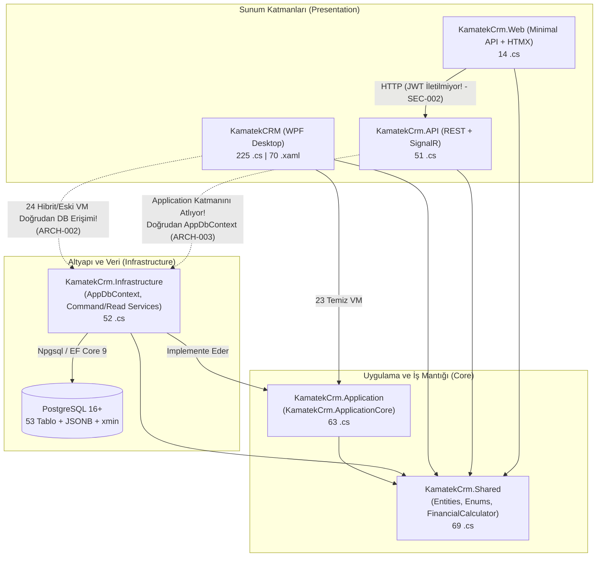

# KamatekCRM — Kapsamlı Mimari, Mühendislik, Güvenlik ve UI/UX Tasarım Denetim Raporu

**Denetim Tarihi:** 28 Ekim 2026  
**Denetlenen Çözüm:** `KamatekCRM.sln` (.NET 9.0 / WPF / ASP.NET Core Web API / Minimal API + HTMX / EF Core 9 / PostgreSQL)  
**Denetim Modu:** Salt Okunur (Read-Only) Kanıt Tabanlı Kod ve Tasarım Denetimi  
**Denetçi Kimliği:** Baş Yazılım Mimarı & Kıdemli UI/UX Sanat Yönetmeni (Design Director)

---

## 1. YÖNETİCİ ÖZETİ

### 1.1. Genel Sağlık Puanı: **54 / 100** *(Koşullu / Üretim Öncesi Kritik Müdahale Gerekli)*

KamatekCRM; kapsamlı iş alanı modellemesi (Teknik Servis, Keşif/Teklif/Montaj İş Akışı, POS Perakende Satış, Satınalma, Stok Sayım, Saha Rota Planlama, Müşteri Etkileşimleri), `FinancialCalculator` ile kuruş dengelemeli hesaplama altyapısı, `ActivityLogIntegrity` (SHA-256) denetim izi mühürlemesi ve `Result<T>` tabanlı yeni nesil `Command/Read` servisleri gibi güçlü kurumsal temellere sahiptir.

Buna karşın, kod tabanının büyük bölümünün yapay zekâ destekli parçalı iterasyonlarla geliştirilmiş olması nedeniyle **monolitik WPF yapısından Clean Architecture yapısına geçiş yarım kalmış**, veri bütünlüğünü, güvenliği ve görsel tutarlılığı doğrudan tehdit eden **gizli ancak yıkıcı hatalar** oluşmuştur.

| Denetim Boyutu | Ağırlık | Puan (100) | Gerekçe Özeti |
| :--- | :---: | :---: | :--- |
| **A. Mimari ve Tasarım** | %15 | **52** | Yarım kalmış Clean Architecture geçişi (47 ViewModel'in 24'ü hâlâ `Infrastructure`/`AppDbContext`'e bağımlı), WPF'de `AddScoped` servislerin root container'dan çözülerek gizli Singleton'a dönüşmesi, God Class'lar (`ServiceJobViewModel`: 2.857 satır). |
| **B. Hata, Doğruluk ve Finans** | %20 | **48** | `ServiceJob` düzenlemede `CurrentValues.SetValues` yüzünden kritik alanların sıfırlanması, KDV hariç tutarın `TotalAmount` olarak kaydedilmesi, iş emri kapanışında `StockTransaction`/Cari/Kasa hareketlerinin oluşmaması, PDF ödeme planı ile genel toplam uyumsuzluğu. |
| **C. Veritabanı ve EF Core** | %15 | **46** | `AppDbContext.SaveChanges` içinde `DbUpdateConcurrencyException` yakalanıp `OriginalValues` ezilerek (`xmin` korumasını tamamen devre dışı bırakan) sessizce yeniden kaydedilmesi, `EnableRetryOnFailure` ile çakışan doğrudan `BeginTransactionAsync` çağrıları, `Task.WhenAll` üzerinde paralel `DbContext` kullanımı. |
| **D. Güvenlik (OWASP & KVKK)** | %15 | **42** | `UsersController`'da rol kontrolü olmaması nedeniyle herhangi bir kullanıcının kendini `Admin` yapabilmesi ve `admin` şifresini sıfırlayabilmesi, WPF (`BCrypt`) ile API (`PBKDF2`) şifre algoritması uyumsuzluğu, `appsettings.json` içinde açık metin DB parolası ve üretim `Jwt:Key`. |
| **E. Performans ve Hız** | %10 | **62** | `FinanceViewModel` ve `FinanceController` içinde tüm geçmiş kasa hareketlerinin `.ToListAsync()` ile RAM'e çekilmesi, `FinanceView.xaml` DataGrid'de `CanContentScroll="False"` ile sanallaştırmanın kapatılması, `NetworkSettingsViewModel` içinde durdurulmayan `DispatcherTimer` sızıntısı. |
| **F. Kod Kalitesi ve Test** | %10 | **64** | 4 projede `<NoWarn>CS8602;CS8604;CS8625</NoWarn>` ile null güvenliğinin kapatılması, 3 ayrı `Result` sınıfı, NuGet sürüm uyumsuzlukları (`MediatR` 14 vs 12, `.NET 10` paketleri), 47 ViewModel'den yalnızca 2'sinin test edilmesi ve `UseInMemoryDatabase` transaction körlüğü. |
| **G. Teknik Borç & Ölçeklenme** | %5 | **58** | İkiye bölünmüş migration zinciri (`KamatekCRM` vs `KamatekCrm.Infrastructure`) ve `KamatekCrm.API`'nin boş migration assembly'sine bakması, kök dizindeki `PostgresData` ve `TencentDB-Agent-Memory` kalıntıları. |
| **H. XAML ve UI/UX Tasarım** | %10 | **58** | Aktif temalarda tanımlı olmayan **33 kırık `DynamicResource`** (`BorderSubtleBrush` 145 yerde tanımsız; `SurfaceSidebarColorValue` yüzünden açık temada görünmez beyaz logo), **10 ekranda ters çalışan `Inverse` görünürlük dönüştürücüsü**, `ControlTemplate`'i yazılmamış **4 hayalet `Km*` bileşeni** (`KmAvatar` 0x0 piksel), `MidnightDark` temada mavi buton üstünde siyah yazı (`TextInverseBrush`). |
| **AĞIRLIKLI GENEL PUAN** | **%100** | **54 / 100** | **Üretim ortamında veri kaybı, yetki aşımı ve görsel bozulma riskleri barındırmaktadır.** |

---

### 1.2. En Kritik 10 Sorun (Acil Müdahale Listesi)

1. **[DB-001] `AppDbContext.SaveChanges` İçinde `xmin` Eşzamanlılık Korumasının Sessizce Ezilmesi ("Silent Last-Write-Wins"):** `AppDbContext.cs:658-689` ve `747-771` satırları `DbUpdateConcurrencyException` istisnasını yakalayıp `entry.OriginalValues.SetValues(databaseValues)` ile veritabanındaki `xmin`'i kopyalayarak eski veriyi zorla üzerine yazar. Stok ve finans servislerindeki hiçbir `catch (DbUpdateConcurrencyException)` bloğu çalışmaz; eşzamanlı satışlarda stok ve bakiye güncellemeleri sessizce kaybolur.
2. **[SEC-001] API `UsersController` Yetki Yükseltme (Privilege Escalation) ve Hesap Ele Geçirme (Account Takeover):** `UsersController.cs:11, 114, 196` üzerinde yalnızca `[Authorize]` vardır; rol veya kullanıcı ID kontrolü yoktur. Herhangi bir düşük yetkili kullanıcı `PUT /api/users/{id}` ile kendi rolünü `"Admin"` yapabilir veya `POST /api/users/1/change-password` ile eski şifreyi bilmeden sistem yöneticisinin şifresini değiştirebilir.
3. **[SEC-002] Masaüstü (`BCrypt`) ile Web API (`PBKDF2`) Şifre Hash Uyumsuzluğu ve `Web` Katmanında JWT Kaybı:** WPF `AuthService.cs:132-181` şifreleri `BCrypt` (`$2a$11$...`) ile hash'lerken, `KamatekCrm.API\Controllers\AuthController.cs:138-141` yalnızca 48-byte Base64 `PBKDF2` kabul eder. WPF'de oluşturulan veya giriş yapan hiçbir kullanıcı API/Web üzerinden giriş yapamaz. Ayrıca `KamatekCrm.Web\Features\Auth\AuthEndpoints.cs:96-112` API'den aldığı JWT token'ı saklamadığı için tüm Web -> API istekleri `401 Unauthorized` alır.
4. **[BUG-001] İş Emri Düzenlemede Veri Silinmesi (`CurrentValues.SetValues`), KDV Hariç Kayıt ve Eksik Stok/Cari/Kasa Hareketleri:** `ServiceJobViewModel.cs:2291-2317` yeni bir `ServiceJob` nesnesi oluşturup yalnız 16 alanı doldurur; `ServiceJobCommandService.cs:140` ise `CurrentValues.SetValues` çağırdığı için mevcut iş emrinin `IsStockDeducted`, `Title`, `DeviceBrand`, `SerialNumber` gibi diğer tüm alanlarını veritabanında sıfırlar (`IsStockDeducted = false` olduğu için stok ikinci kez düşülür!). Ayrıca `TotalAmount` KDV hariç kaydedilir ve iş tamamlandığında `StockTransaction`, `Transaction` (Cari) ve `CashTransaction` (Kasa) kayıtları oluşturulmaz.
5. **[UI-001] 10 Ekranda Ters Çalışan `Inverse` / `Invert` Görünürlük Dönüştürücüsü ve `DirectSalesWindow` Kırık Popup Bağlaması:** `App.xaml:143`'teki `Converters.NullToVisibilityConverter` ve standart `BooleanToVisibilityConverter` `ConverterParameter=Inverse` değerini yok sayar. Bu yüzden `ServiceJobsView`, `CustomersView`, `RepairListView`, `UsersView`, `ManagerAgendaView`, `StockCountView` dahil **10 ekranda** boş durum (`KmEmptyState`) ve filtre panelleri tam tersi çalışır (seçim yokken gizlenir, seçim varken detayların üstüne biner). `DirectSalesWindow.xaml:486`'da ise `Popup.IsOpen` (`bool`) özelliğine `Visibility` döndüren converter bağlandığı için müşteri arama popup'ı asla açılmaz.
6. **[UI-002] Aktif Temalarda Tanımsız 33 `DynamicResource` Anahtarı ve Görünmez Sol Menü / Kart Başlıkları:** `BorderSubtleBrush` 145 noktada kullanılmasına rağmen hiçbir temada tanımlı değildir. `MainContentView.xaml:140-160` ve `DashboardView.xaml:308` içinde tanımsız `SurfaceSidebarColorValue` ve `KpiPurpleStartColor` struct `Color` olarak `#00000000` (şeffaf) döndürdüğü için, açık temada beyaz `"KAMATEK CRM"` logosu ve `"Teslime Hazır Cihazlar"` başlığı açık zemin üzerinde tamamen görünmez olmaktadır (kontrast `1.09:1`).
7. **[ARCH-001] WPF'de `AddScoped` Servislerin Root Container'dan Çözülmesi (Gizli Singleton & Captive `AppDbContext`):** `IUnitOfWork`, `ICustomerAppService`, `IInventoryDomainService`, `IDirectSalesService` `AddScoped` olarak kaydedilmiş ancak `NavigationService` ViewModel'leri scope açmadan doğrudan root `_serviceProvider` üzerinden çözmektedir. Bu servisler ve içlerindeki `AppDbContext` örnekleri uygulama kapanana kadar tek bir Singleton olarak bellekte kalır.
8. **[DB-002] `EnableRetryOnFailure` Aktifken Doğrudan `BeginTransactionAsync` Çağrılması ve `Task.WhenAll` Paralel `DbContext` Çökmesi:** `FaultTicketViewModel.cs:533`, `RepairViewModel.cs:526` ve `SlaService.cs:32` doğrudan `ctx.Database.BeginTransactionAsync()` çağırdığı için `NpgsqlRetryingExecutionStrategy` altında çalışma zamanında `InvalidOperationException` fırlatır. `DashboardController.cs:38-50` ve `ReportsController.cs:62-74` ise aynı `_context` üzerinde `Task.WhenAll` ile paralel sorgu çalıştırarak çökme üretir.
9. **[SEC-003] Kaynak Kodda ve `appsettings.json` İçinde Açık Metin Veritabanı Parolası (`1313` / `123456`) ve Paylaşılan Üretim JWT Anahtarı:** Hem `KamatekCRM\appsettings.json` (istemciye dağıtılan masaüstü paketi) hem de `KamatekCrm.API\appsettings.json` aynı simetrik `Jwt:Key` anahtarını ve `postgres` süper kullanıcı parolasını açık metin olarak barındırmaktadır. Masaüstü uygulamasına erişen herkes `Admin` rolünde geçerli JWT üretebilir.
10. **[UI-003] Şablonsuz 4 Hayalet `Km*` Bileşeni (`KmAvatar`, `KmWizardStepper`, `KmSplitButton`, `KmNotificationCenter`) ve Koyu Temada Siyah Buton Yazıları (`TextInverseBrush`):** `KmAvatar` C# sınıfı yazılmış ve `CustomersView` / `UsersView` içine yerleştirilmiş ancak XAML `ControlTemplate`'i hiç yazılmadığı için ekranda `0x0` piksel görünmez kalmaktadır. Ayrıca `Theme.MidnightDark.xaml:56` içinde `TextInverseColor` `#020617` (siyah) tanımlandığı için koyu temada tüm mavi birincil butonların yazıları siyaha dönmektedir.

---

### 1.3. En Büyük 5 Fırsat (Yüksek Kaldıraçlı İyileştirme Alanları)

1. **Tasarım Sistemi (`Theme.*.xaml` + `ComponentStyles.xaml`) Tek Noktadan Onarımı:** Yalnızca 3 tema dosyasına eksik 12 token'ın (`BorderSubtleBrush`, `TextInverseColor` düzeltmesi vb.) eklenmesi, `App.xaml:143`'teki `NullToVis` kaydının `Helpers.NullToVisibilityConverter` ile değiştirilmesi ve `KmAvatar` şablonunun eklenmesiyle **tek bir iş gününde 20+ ekrandaki yüzlerce görsel hata aynı anda düzelecektir.**
2. **Altyapıda Hazır Olan Modern Kalıpların Tüm Katmanlara Yayılması:** `KamatekCrm.Application` ve `KamatekCrm.Infrastructure` içinde zaten geliştirilmiş olan `Result<T>`, `FinancialCalculator.CalculateMultiLine`, `DbContextTransactionExtensions.ExecuteInTransactionAsync`, `ActivityLogIntegrity` ve `IDbContextFactory<AppDbContext>` altyapıları çok sağlamdır; kalan hibrit ViewModel'ler ve API Controller'lar bu hazır servislere bağlandığında kod tekrarı %40 azalacaktır.
3. **Merkezi Paket Yönetimi (`Directory.Packages.props`) ve Nullability Temizliği:** 7 projedeki NuGet sürüm dağınıklığının tek bir `Directory.Packages.props` dosyasıyla birleştirilmesi ve `<NoWarn>CS8602;CS8604;CS8625</NoWarn>` kaldırılarak derleyici destekli null güvenliğinin kazanılması.
4. **PostgreSQL Sunucu Taraflı Sorgulama ve Sanallaştırma ile 10x Performans Artışı:** `FinanceViewModel`, `FinanceController`, `ServiceJobsController` ve `ReportService` içindeki `.ToList()` sonrası bellek içi toplama işlemlerinin SQL `SumAsync`/`GroupBy` sorgularına çevrilmesi ve DataGrid sanallaştırmasının açılmasıyla ekran açılış süreleri milisaniyelere inecektir.
5. **Gerçek Çok-Birimli (`TRY`/`USD`/`EUR`) Finans ve Birleşik İş Emri Muhasebesi:** İş emri teslimatı (`CompleteDeliveryAsync`), stok hareketi (`StockTransaction`), cari ekstre (`Transaction`) ve kasa (`CashTransaction`) tablolarının tek bir atomik domain olayıyla bağlanması, KamatekCRM'i tam entegre bir kurumsal ERP seviyesine taşıyacaktır.

---

## 2. PROJE HARİTASI VE MİMARİ ŞEMA

### 2.1. Katmanlar, Projeler ve Dosya Dağılımı

| Proje Adı | Hedef Çerçeve | `.cs` | `.xaml` / `.cshtml` | Sorumluluk ve Mevcut Durum |
| :--- | :--- | :---: | :---: | :--- |
| **`KamatekCRM`** | `net9.0-windows` | 225 | 70 `.xaml` | WPF Masaüstü İstemcisi (Views, ViewModels, Custom Controls, PDF/Excel/Print/Backup/Auth Servisleri). Doğrudan PostgreSQL'e bağlanır (`Direct Database Mode`). |
| **`KamatekCrm.Application`** | `net9.0` | 63 | — | Use-Case Arayüzleri (`IServiceJobCommandService`, `IRetailTransactionService` vb.), DTO'lar, `Result<T>`, `ApplicationAuthorizationService`, `PersonalDataProtectionService`. *(Kod içi kök namespace: `KamatekCrm.ApplicationCore`)* |
| **`KamatekCrm.Infrastructure`** | `net9.0` | 52 | — | `AppDbContext` (53 `DbSet`), `UnitOfWork`, `Repository<T>`, 12 adet Command/Read Servisi, EF Core Migration'ları (`Migrations\`). |
| **`KamatekCrm.Shared`** | `net9.0` | 69 | — | Domain Entity'leri (`Customer`, `ServiceJob`, `Product`, `SalesOrder` vb.), JSONB Spec/JobDetail modelleri, Enum'lar, `FinancialCalculator`, `ActivityLogIntegrity`. |
| **`KamatekCrm.API`** | `net9.0` | 51 | — | ASP.NET Core Web API (17 Controller, SignalR `NotificationHub`, MediatR CQRS handler'ları). **`KamatekCrm.Application` katmanına referansı yoktur!** |
| **`KamatekCrm.Web`** | `net9.0` | 14 | 12+ HTML/HTMX | Saha teknisyenleri ve web erişimi için Minimal API + HTMX + SSR portalı. `HttpClient` (`ApiClient`) üzerinden `KamatekCrm.API`'ye bağlanır. |
| **`KamatekCrm.Tests`** | `net9.0-windows` | 40 | — | xUnit + Moq + FluentAssertions test projesi (38 test sınıfı, 239 test metodu). Yalnızca `KamatekCRM` ve `Shared`'e referans verir; `API` ve `Web` test edilmez. |
| **`MvvmRefactorTool`** *(Çözüm dışı)* | `net10.0` | 1 | — | Kök dizinde bırakılmış tek kullanımlık regex tabanlı `[RelayCommand]` dönüştürme konsol aracı. |

### 2.2. Mevcut Mimari ve Bağımlılık Diyagramı (Mermaid)



---

## 3. DETAYLI BULGULAR (MÜHENDİSLİK, VERİTABANI VE GÜVENLİK)

---

### A. MİMARİ VE TASARIM BULGULARI

#### [ARCH-001] WPF Masaüstü Uygulamasında `AddScoped` Servislerin Root Container Üzerinden Çözülmesi (Gizli Singleton ve Captive `AppDbContext`)
- **Kategori:** Mimari / Dependency Injection
- **Önem:** Kritik
- **Kesinlik:** `[Kesin]`
- **Konum:**
  - [ServiceCollectionExtensions.cs](file:///c:/Antigravity/KamatekCRM/Extensions/ServiceCollectionExtensions.cs#L22-L78) (`satır 22, 68, 73, 77, 78`)
  - [DependencyInjection.cs](file:///c:/Antigravity/KamatekCrm.Infrastructure/DependencyInjection.cs#L51-L52) (`satır 51-52`)
  - [DependencyInjection.cs](file:///c:/Antigravity/KamatekCrm.Application/DependencyInjection.cs#L16-L18) (`satır 16-18`)
  - [NavigationService.cs](file:///c:/Antigravity/KamatekCRM/Services/NavigationService.cs#L16-L45) (`satır 16-45`)
  - [UnitOfWork.cs](file:///c:/Antigravity/KamatekCrm.Infrastructure/Repositories/UnitOfWork.cs#L20-L24) (`satır 20-24`)
- **Sorun:**
  1. `IUnitOfWork`, `IRepository<>`, `ICustomerAppService`, `IUserAppService`, `IServiceJobAppService`, `IDirectSalesService`, `IInventoryDomainService`, `ISlaService`, `IBackupService` servisleri `AddScoped` olarak kaydedilmiştir.
  2. Ancak WPF masaüstü uygulamasında ASP.NET Core'daki gibi istek bazlı bir `IServiceScope` yoktur. Singleton olan `NavigationService`, tüm ViewModel'leri doğrudan root `_serviceProvider.GetRequiredService<TViewModel>()` ile çözer.
  3. Root container'dan çözülen `Scoped` servisler uygulama kapanana kadar **tek bir Singleton örneği** olarak yaşar! `UnitOfWork` constructor'ında oluşturulan `_context = _contextFactory.CreateDbContext()` uygulama boyunca hiç dispose edilmez.
  4. Ayrıca `ServiceCollectionExtensions.cs:22`'deki `services.AddTransient<AppDbContext>(sp => ...)` kaydı, `IDisposable` olan `AppDbContext` her çözüldüğünde (`AnalyticsViewModel`, `RoutePlanningViewModel`) root container tarafından referans listesinde tutulduğu için GC tarafından toplanmasını engeller.
- **Etki / Risk:**
  - `UnitOfWork._context` içindeki EF Core `ChangeTracker` uygulama açık kaldığı sürece büyür (bellek sızıntısı), veritabanında başka kullanıcıların yaptığı değişiklikler ekrana yansımaz (stale cache) ve iki ekran aynı anda `IUnitOfWork` kullandığında eşzamanlı `DbContext` erişim hatası oluşur.
  - Ortam değişkeni `DOTNET_ENVIRONMENT=Development` yapıldığında `Host.CreateDefaultBuilder()` `ValidateScopes = true` etkinleştirdiği için uygulama açılışta `InvalidOperationException: Cannot resolve scoped service 'KamatekCrm.Shared.Repositories.IUnitOfWork' from root provider` hatasıyla anında çöker.
- **Kanıt:**
```csharp
// KamatekCrm.Infrastructure/DependencyInjection.cs:51-52
services.AddScoped(typeof(IRepository<>), typeof(Repository<>));
services.AddScoped<IUnitOfWork, UnitOfWork>();

// KamatekCRM/Services/NavigationService.cs:40-45 (Singleton servis, root IServiceProvider kullanıyor)
public TViewModel NavigateTo<TViewModel>() where TViewModel : notnull
{
    var vm = _serviceProvider.GetRequiredService<TViewModel>();
    NavigateTo(vm);
    return vm;
}
```
- **Çözüm Önerisi:**
```csharp
// ÖNCE (KamatekCrm.Infrastructure/DependencyInjection.cs & KamatekCRM/Extensions/ServiceCollectionExtensions.cs)
services.AddScoped<IUnitOfWork, UnitOfWork>();
services.AddScoped<IDirectSalesService, DirectSalesService>();
services.AddScoped<IInventoryDomainService, InventoryDomainService>();
services.AddTransient<AppDbContext>(sp => sp.GetRequiredService<IDbContextFactory<AppDbContext>>().CreateDbContext());

// SONRA: Masaüstü uygulamasında servisler Transient olmalı ve kısa ömürlü IDbContextFactory kullanmalıdır;
// veya NavigationService her ekran geçişinde yeni bir IServiceScope oluşturup eski scope'u Dispose etmelidir.
services.AddTransient<IUnitOfWork, UnitOfWork>();
services.AddTransient<IDirectSalesService, DirectSalesService>();
services.AddTransient<IInventoryDomainService, InventoryDomainService>();
// AddTransient<AppDbContext> kaldırılmalı; AnalyticsViewModel ve RoutePlanningViewModel IDbContextFactory kullanmalıdır.
```
- **Çaba:** Orta
- **Dayanak:** Microsoft .NET Dependency Injection Guidelines — *Captive Dependencies & Disposing of Services resolved from Root Container*.

---

#### [ARCH-002] Yarım Kalmış Clean Architecture Geçişi ve ViewModel Katman İhlalleri (`UnitOfWork` Downcast & Doğrudan `AppDbContext`)
- **Kategori:** Mimari
- **Önem:** Yüksek
- **Kesinlik:** `[Kesin]`
- **Konum:**
  - [SuppliersViewModel.cs](file:///c:/Antigravity/KamatekCRM/ViewModels/SuppliersViewModel.cs#L95-L181) (`satır 95, 144, 149-152, 181`)
  - [AnalyticsViewModel.cs](file:///c:/Antigravity/KamatekCRM/ViewModels/AnalyticsViewModel.cs#L18-L22) (`satır 18-22`)
  - [RoutePlanningViewModel.cs](file:///c:/Antigravity/KamatekCRM/ViewModels/RoutePlanningViewModel.cs#L25-L31) (`satır 25-31`)
  - [ProductViewModel.cs](file:///c:/Antigravity/KamatekCRM/ViewModels/ProductViewModel.cs#L29-L30) (`satır 29-30, 202`)
  - [FaultTicketViewModel.cs](file:///c:/Antigravity/KamatekCRM/ViewModels/FaultTicketViewModel.cs#L343-L522) (`satır 343, 366, 399, 522`)
  - [RepairListViewModel.cs](file:///c:/Antigravity/KamatekCRM/ViewModels/RepairListViewModel.cs#L243-L662) (`satır 243, 263, 288, 311, 392, 607, 662`)
- **Sorun:**
  - Toplam 47 ViewModel'in 23'ü `KamatekCrm.ApplicationCore` servislerine geçirilmişken, **24 ViewModel** hâlâ doğrudan `KamatekCrm.Infrastructure` katmanındaki `AppDbContext`, `IDbContextFactory<AppDbContext>` veya somut `UnitOfWork` sınıfına erişmektedir.
  - Özellikle `SuppliersViewModel.cs:95, 149, 181` içinde enjekte edilen `IUnitOfWork` arayüzü `((UnitOfWork)_unitOfWork).Context.Suppliers` şeklinde somut `Infrastructure` sınıfına downcast edilerek soyutlama tamamen delinmiştir.
- **Etki / Risk:** İş kuralları UI katmanı ile Infrastructure katmanı arasında ikiye bölünmüştür; aynı iş kuralı (örneğin iş emri oluşturma veya stok düşümü) `ServiceJobCommandService`, `FaultTicketViewModel`, `RepairViewModel` ve `ServiceJobsController` içinde 4 farklı şekilde çalışmaktadır.
- **Kanıt:**
```csharp
// KamatekCRM/ViewModels/SuppliersViewModel.cs:95 & 149-152
var query = ((UnitOfWork)_unitOfWork).Context.Suppliers.AsQueryable();
...
if (SelectedSupplier.Id == 0)
{
    ((UnitOfWork)_unitOfWork).Context.Suppliers.Add(SelectedSupplier);
}
```
- **Çözüm Önerisi:**
  - `SuppliersViewModel`, `AnalyticsViewModel`, `RoutePlanningViewModel`, `ProductViewModel`, `FaultTicketViewModel` ve `RepairListViewModel` içindeki doğrudan `AppDbContext` sorguları `KamatekCrm.Application` katmanındaki Read/Command servislerine taşınmalı; `KamatekCRM` içindeki ViewModel'lerden `using KamatekCrm.Infrastructure.Data;` ve `using KamatekCrm.Infrastructure.Repositories;` bağımlılıkları temizlenmelidir.
- **Çaba:** Büyük
- **Dayanak:** Robert C. Martin — *Clean Architecture (The Dependency Rule)*; Liskov Substitution / Dependency Inversion Principle (SOLID).

---

#### [ARCH-003] `KamatekCrm.API` Projesinin `KamatekCrm.Application` Katmanından Kopuk Olması ve Kırık Çoklu Migrasyon Yapısı
- **Kategori:** Mimari
- **Önem:** Kritik
- **Kesinlik:** `[Kesin]`
- **Konum:**
  - [KamatekCrm.API.csproj](file:///c:/Antigravity/KamatekCrm.API/KamatekCrm.API.csproj#L42-L46) (`satır 42-46`)
  - [Program.cs](file:///c:/Antigravity/KamatekCrm.API/Program.cs#L31-L35) (`satır 31-35, 182`)
  - [KamatekCrm.Infrastructure.csproj](file:///c:/Antigravity/KamatekCrm.Infrastructure/KamatekCrm.Infrastructure.csproj#L34-L36) (`satır 34-36`)
- **Sorun:**
  1. `KamatekCrm.API.csproj` dosyası `KamatekCrm.Application` projesine referans vermez ve `AddInfrastructureServices` / `AddApplicationLayerServices` metotlarını çağırmaz. Bunun yerine API kendi içinde paralel ve eksik bir iş mantığı (`KamatekCrm.API\Services\SalesDomainService.cs`, `KamatekCrm.API\Application\...`) barındırır.
  2. `KamatekCrm.API\Program.cs:34` satırında `npgsqlOptions.MigrationsAssembly("KamatekCrm.API")` tanımlanmıştır; oysa gerçek migration zinciri `KamatekCrm.Infrastructure` assembly'sindedir. Bu nedenle `Program.cs:182`'deki `context.Database.Migrate()` çağrısı güncel şemayı oluşturamaz.
- **Etki / Risk:** Masaüstü uygulaması ile Web API aynı veritabanı üzerinde farklı iş kuralları ve farklı şema beklentileriyle çalışır; API üzerinden yapılan satış ve servis işlemleri masaüstü tarafındaki muhasebe ve stok kurallarını bozar.
- **Kanıt:**
```csharp
// KamatekCrm.API/Program.cs:31-35
builder.Services.AddDbContext<AppDbContext>(options =>
    options.UseNpgsql(connectionString, npgsqlOptions =>
    {
        npgsqlOptions.MigrationsAssembly("KamatekCrm.API");
    }));
```
- **Çözüm Önerisi:**
```csharp
// SONRA (KamatekCrm.API/Program.cs)
builder.Services.AddInfrastructureServices(builder.Configuration);
KamatekCrm.ApplicationCore.DependencyInjection.AddApplicationLayerServices(builder.Services);
```
- **Çaba:** Orta
- **Dayanak:** EF Core Official Docs — *Managing Migrations in Multi-Project Solutions*.

---

#### [ARCH-004] `App.ServiceProvider` (Service Locator Anti-Pattern) Kullanımları ve `CustomerAddWindow.xaml.cs` Null Dereference Hatası
- **Kategori:** Mimari / MVVM
- **Önem:** Yüksek
- **Kesinlik:** `[Kesin]`
- **Konum:**
  - [CustomerAddWindow.xaml.cs](file:///c:/Antigravity/KamatekCRM/Views/CustomerAddWindow.xaml.cs#L10-L12) (`satır 10-12`)
  - [EditUserView.xaml.cs](file:///c:/Antigravity/KamatekCRM/Views/EditUserView.xaml.cs#L21-L23) (`satır 21-23`)
  - [PasswordResetView.xaml.cs](file:///c:/Antigravity/KamatekCRM/Views/PasswordResetView.xaml.cs#L16-L17) (`satır 16-17`)
  - [ProductViewModel.cs](file:///c:/Antigravity/KamatekCRM/ViewModels/ProductViewModel.cs#L283-L678) (`satır 283, 308, 678`)
  - [SensitiveDataConverter.cs](file:///c:/Antigravity/KamatekCRM/Converters/SensitiveDataConverter.cs#L33) (`satır 33`)
- **Sorun:**
  - Kod tabanında 16 farklı noktada statik `App.ServiceProvider` üzerinden bağımlılık çözülmektedir.
  - `CustomerAddWindow.xaml.cs:10-12`'de ise `App.ServiceProvider != null` koşulunun `false` kolunda (`App.ServiceProvider` `null` iken!) `App.ServiceProvider!` zorla dereference edilerek kesin `ArgumentNullException` üretilmiştir.
- **Etki / Risk:** Gizli bağımlılıklar nedeniyle sınıflar birim testlerde başlatılamaz (`App.ServiceProvider` test ortamında `null` olduğu için çöker).
- **Kanıt:**
```csharp
// KamatekCRM/Views/CustomerAddWindow.xaml.cs:10-12
var viewModel = App.ServiceProvider != null 
    ? Microsoft.Extensions.DependencyInjection.ServiceProviderServiceExtensions.GetRequiredService<ViewModels.CustomerAddViewModel>(App.ServiceProvider)
    : new ViewModels.CustomerAddViewModel(Microsoft.Extensions.DependencyInjection.ServiceProviderServiceExtensions.GetRequiredService<Microsoft.EntityFrameworkCore.IDbContextFactory<Infrastructure.Data.AppDbContext>>(App.ServiceProvider!));
```
- **Çözüm Önerisi:** Pencere oluşturma ve gösterme işlemleri `IProjectQuoteEditorLauncher` örneğinde olduğu gibi DI'a kayıtlı bir `IWindowService` üzerinden yapılmalı; ViewModel'ler constructor injection ile alınmalıdır.
- **Çaba:** Orta
- **Dayanak:** Mark Seemann — *Dependency Injection in .NET (Service Locator is an Anti-Pattern)*.

---

#### [ARCH-005] God Class / God ViewModel Yığılması ve ViewModel İçinde Doğrudan WPF Pencere/Dialog Çağrıları
- **Kategori:** Mimari / MVVM
- **Önem:** Yüksek
- **Kesinlik:** `[Kesin]`
- **Konum:**
  - [ServiceJobViewModel.cs](file:///c:/Antigravity/KamatekCRM/ViewModels/ServiceJobViewModel.cs#L30-L2857) (2.857 satır)
  - [ServiceJobCommandService.cs](file:///c:/Antigravity/KamatekCrm.Infrastructure/Services/ServiceJobCommandService.cs#L19-L2085) (2.085 satır)
  - [PdfService.cs](file:///c:/Antigravity/KamatekCRM/Services/PdfService.cs#L19-L2058) (2.058 satır, 7 arayüz implementasyonu)
  - [ProjectQuoteEditorViewModel.cs](file:///c:/Antigravity/KamatekCRM/ViewModels/ProjectQuoteEditorViewModel.cs#L1-L1201) (1.201 satır)
  - [ProductPickerWindow.xaml.cs](file:///c:/Antigravity/KamatekCRM/Views/ProductPickerWindow.xaml.cs#L17-L108) (ViewModel'siz 110 satır code-behind iş mantığı)
- **Sorun:**
  - `ServiceJobViewModel` tek başına 7 ayrı ekran/form sorumluluğunu taşır ve `satır 124`'teki parametresiz constructor'ı (`public ServiceJobViewModel() : this(null!, ...)`) çağrıldığında `satır 120`'deki `_ = Refresh();` yüzünden anında `NullReferenceException` fırlatır.
  - Projede `IDialogService` ve `IUIService` bulunmasına rağmen 16 ViewModel doğrudan `MessageBox.Show`, 15 ViewModel doğrudan `new ...Window().ShowDialog()` ve 7 ViewModel doğrudan `OpenFileDialog` çağırmaktadır.
- **Etki / Risk:** Bakım maliyeti çok yüksektir; 47 ViewModel'in 45'i UI bağımlılıkları nedeniyle otomatik test edilememektedir.
- **Kanıt:**
```csharp
// KamatekCRM/ViewModels/ServiceJobViewModel.cs:120-127
    _ = Refresh();
}

public ServiceJobViewModel()
    : this(null!, null!, null!, null!, null!, null!, null!)
{
}
```
- **Çözüm Önerisi:**
  - `ServiceJobViewModel` içindeki yeni iş emri oluşturma sihirbazı `NewServiceJobWizardViewModel` olarak, liste ve filtreleme ise `ServiceJobListViewModel` olarak ayrıştırılmalı; parametresiz constructor kaldırılmalıdır.
  - `PdfService` belge türlerine göre (`QuotePdfGenerator`, `WorkOrderPdfGenerator`, `InvoicePdfGenerator`) 3 ayrı sınıfa bölünmeli ve ortak başlık/altbilgi bileşenleri `PdfLayoutComposer` yardımcı sınıfına alınmalıdır.
- **Çaba:** Büyük
- **Dayanak:** Single Responsibility Principle (SRP) & Interface Segregation Principle (ISP).

---

### B. HATA, DOĞRULUK, ASYNC VE FİNANSAL İŞ MANTIĞI BULGULARI

#### [BUG-001] İş Emri Kayıt/Düzenleme Akışında Veri Kaybı (`CurrentValues.SetValues`), KDV Hariç `TotalAmount` Kaydı ve Eksik Stok/Cari/Kasa Hareketleri
- **Kategori:** Hata / Finansal ve İş Kuralı Doğruluğu
- **Önem:** Kritik
- **Kesinlik:** `[Kesin]`
- **Konum:**
  - [ServiceJobViewModel.cs](file:///c:/Antigravity/KamatekCRM/ViewModels/ServiceJobViewModel.cs#L383-L385) (`satır 383-385, 2291-2317`)
  - [ServiceJobCommandService.cs](file:///c:/Antigravity/KamatekCrm.Infrastructure/Services/ServiceJobCommandService.cs#L137-L144) (`satır 137-144, 1492-1592, 1950-2059`)
- **Sorun:**
  1. **Düzenleme Sırasında Veri Silinmesi:** `ServiceJobViewModel.SaveServiceJob` (`satır 2291-2317`) düzenleme modunda bile `var jobToSave = new ServiceJob { ... }` ile yeni bir nesne oluşturup yalnız 16 özelliği atar. `ServiceJobCommandService.SaveAsync` (`satır 140`) ise `context.Entry(trackedJob).CurrentValues.SetValues(request.Job)` çağırır. `SetValues` metodu `jobToSave` içinde atanmamış olan **tüm diğer özellikleri varsayılan (`false` / `null` / `0`) değerleriyle ezer!**
     - Sonuç: Düzenlenen iş emrinde `IsStockDeducted` `false`'a sıfırlanır (iş tekrar kaydedildiğinde **stok ikinci kez düşülür!**), `IsStockReserved`, `IsConvertedToQuote`, `Title`, `ServiceProjectId`, `DeviceBrand`, `DeviceModel`, `SerialNumber`, `CustomerAssetId`, `DiscoveryTechnicalNotes` veritabanından silinir!
  2. **KDV Hariç Tutarın `TotalAmount` Olarak Kaydedilmesi:** `ServiceJobViewModel.cs:383-385`'te `GrandTotal => MaterialTotal + LaborCost - DiscountAmount` (KDV hariç!) ve `GrandTotalWithKdv => SubTotal + KdvAmount` tanımlanmış; ancak `satır 2316`'da veritabanına `TotalAmount = GrandTotal` (KDV hariç!) ve yuvarlanmamış `TaxAmount = KdvAmount` kaydedilmiştir. Ayrıca `jobToSave.Price` hiç atanmadığı için `0` kalmaktadır.
  3. **İş Tamamlandığında / Teslim Edildiğinde Muhasebe ve Stok Ekstresi Boşluğu:** `ServiceJobCommandService.ApplyStockCompletionAsync` (`satır 1985-1990`) depo stoğunu düşürürken `StockTransactions` tablosuna hiçbir hareket kaydı atmaz. `ApplyCustomerCompletionAsync` (`satır 2034-2059`) ve `CompleteDeliveryAsync` (`satır 1492-1592`) ise müşteri cari ekstresine (`Transactions`) borç/tahsilat ve kasaya (`CashTransactions`) gelir kaydı oluşturmaz.
- **Etki / Risk:** Mevcut bir iş emrini güncelleyen kullanıcı cihaz bilgilerini ve proje bağlantısını kaybeder, stok mükerrer düşer, KDV tutarı toplam fiyata yansımaz ve servis/montaj tahsilatları kasa/cari hesaplarda görünmez.
- **Kanıt:**
```csharp
// KamatekCRM/ViewModels/ServiceJobViewModel.cs:383-385 & 2315-2316
public decimal SubTotal => MaterialTotal + LaborCost - DiscountAmount;
public decimal KdvAmount => SubTotal * (KdvRate / 100m);
public decimal GrandTotalWithKdv => SubTotal + KdvAmount;
...
TaxAmount = KdvAmount,
TotalAmount = GrandTotal // HATA: KDV hariç tutar kaydediliyor, Price ise 0 kalıyor!

// KamatekCrm.Infrastructure/Services/ServiceJobCommandService.cs:140
context.Entry(trackedJob).CurrentValues.SetValues(request.Job); // Atanmayan tüm alanları sıfırlıyor!
```
- **Çözüm Önerisi:**
```csharp
// ÖNCE (ServiceJobCommandService.cs:140)
context.Entry(trackedJob).CurrentValues.SetValues(request.Job);

// SONRA: Yalnızca formda düzenlenen alanlar açıkça güncellenmeli, durum bayrakları (IsStockDeducted vb.) korunmalıdır
trackedJob.CustomerId = request.Job.CustomerId;
trackedJob.JobCategory = request.Job.JobCategory;
trackedJob.WorkOrderType = request.Job.WorkOrderType;
trackedJob.Priority = request.Job.Priority;
trackedJob.Description = request.Job.Description;
trackedJob.AssignedTechnician = request.Job.AssignedTechnician;
trackedJob.AssignedUserId = request.Job.AssignedUserId;
trackedJob.Price = FinancialCalculator.RoundMoney(request.Job.Price);
trackedJob.LaborCost = FinancialCalculator.RoundMoney(request.Job.LaborCost);
trackedJob.DiscountAmount = FinancialCalculator.RoundMoney(request.Job.DiscountAmount);
trackedJob.TaxAmount = FinancialCalculator.RoundMoney(request.Job.TaxAmount);
trackedJob.TotalAmount = FinancialCalculator.RoundMoney(request.Job.TotalAmount);
trackedJob.ScheduledDate = request.Job.ScheduledDate;
trackedJob.SlaDeadline = request.Job.SlaDeadline;
trackedJob.TechnicianNotes = request.Job.TechnicianNotes;
```
- **Çaba:** Orta
- **Dayanak:** EF Core Docs — *ChangeDetector & `PropertyValues.SetValues` Behavior*; Muhasebe Çift Kayıt (Double-Entry) İlkesi.

---

#### [BUG-002] UI Thread Üzerinde `.GetAwaiter().GetResult()` Çağrıları Nedeniyle Klasik WPF Deadlock Riski
- **Kategori:** Hata / Async-Await
- **Önem:** Kritik
- **Kesinlik:** `[Kesin]`
- **Konum:**
  - [CustomerDetailViewModel.cs](file:///c:/Antigravity/KamatekCRM/ViewModels/CustomerDetailViewModel.cs#L334-L338) (`satır 334-338`)
  - [PdfService.cs](file:///c:/Antigravity/KamatekCRM/Services/PdfService.cs#L46-L55) (`satır 46-55`)
  - [InventoryDomainService.cs](file:///c:/Antigravity/KamatekCRM/Services/Domain/InventoryDomainService.cs#L930-L935) (`satır 930-935`)
  - [AuditTrailService.cs](file:///c:/Antigravity/KamatekCrm.Infrastructure/Services/AuditTrailService.cs#L33-L50) (`satır 33-50`)
  - [VelopackUpdateService.cs](file:///c:/Antigravity/KamatekCRM/Services/Update/VelopackUpdateService.cs#L319-L322) (`satır 319-322`)
- **Sorun:**
  - `AuditTrailService.WriteAsync` içinde `await _dbContextFactory.CreateDbContextAsync(...)` ve `await context.SaveChangesAsync(...)` çağrılarında `.ConfigureAwait(false)` **yoktur**.
  - `CustomerDetailViewModel.LoadCustomerData()` ve `PdfService.AuditSensitiveDocumentAccess()` UI thread (WPF `DispatcherSynchronizationContext`) üzerinde çalışırken `_auditTrail.WriteAsync(...).GetAwaiter().GetResult()` çağırır. Veritabanı I/O işlemi senkron tamamlanmadığında (ağ gecikmesi veya bağlantı havuzu beklemesi), `await` sonrası devam işi (continuation) UI thread'e dönmek için beklerken UI thread `.GetResult()` üzerinde bloklu olduğu için **uygulama tamamen kilitlenir (deadlock)**.
- **Etki / Risk:** Müşteri detay kartı açılırken veya PDF teklif/rapor üretilirken ağda milisaniyelik bir gecikme olduğunda WPF arayüzü kalıcı olarak donar (Yanıt Vermiyor).
- **Kanıt:**
```csharp
// KamatekCRM/ViewModels/CustomerDetailViewModel.cs:334-338
var auditResult = _auditTrail.WriteAsync(
    AuditActionType.View,
    nameof(Customer),
    Customer.Id.ToString(),
    $"Müşteri detay kartı görüntülendi: {Customer.CustomerCode}").GetAwaiter().GetResult();

// KamatekCrm.Infrastructure/Services/AuditTrailService.cs:33-46 (ConfigureAwait(false) yok!)
await using var context = await _dbContextFactory.CreateDbContextAsync(cancellationToken);
context.ActivityLogs.Add(new ActivityLog { ... });
await context.SaveChangesAsync(cancellationToken);
```
- **Çözüm Önerisi:**
```csharp
// SONRA (AuditTrailService.cs:33-46 — Altyapı servislerinde ConfigureAwait(false) kullanılmalı)
await using var context = await _dbContextFactory.CreateDbContextAsync(cancellationToken).ConfigureAwait(false);
context.ActivityLogs.Add(new ActivityLog { ... });
await context.SaveChangesAsync(cancellationToken).ConfigureAwait(false);

// SONRA (CustomerDetailViewModel.cs — Metot async Task yapılmalı ve await kullanılmalı)
var auditResult = await _auditTrail.WriteAsync(
    AuditActionType.View,
    nameof(Customer),
    Customer.Id.ToString(),
    $"Müşteri detay kartı görüntülendi: {Customer.CustomerCode}");
```
- **Çaba:** Küçük
- **Dayanak:** Stephen Cleary — *Don't Block on Async Code (MSDN Magazine / Concurrency in C# Cookbook)*.

---

#### [BUG-003] `ServiceJobViewModel` Constructor Fire-and-Forget `_ = Refresh()` Yarış Durumu ve `DirectSalesViewModel` Çift Satış Riski
- **Kategori:** Hata / Concurrency (Race Condition)
- **Önem:** Yüksek
- **Kesinlik:** `[Kesin]`
- **Konum:**
  - [ServiceJobViewModel.cs](file:///c:/Antigravity/KamatekCRM/ViewModels/ServiceJobViewModel.cs#L120-L121) (`satır 120, 1346-1391, 1397-1406, 2081-2122`)
  - [DirectSalesViewModel.cs](file:///c:/Antigravity/KamatekCRM/ViewModels/DirectSalesViewModel.cs#L326-L950) (`satır 326, 751-754, 860-950`)
  - [SuppliersViewModel.cs](file:///c:/Antigravity/KamatekCRM/ViewModels/SuppliersViewModel.cs#L50-L95) (`satır 50-60, 89-95`)
- **Sorun:**
  1. `ServiceJobViewModel` constructor'ı `satır 120`'de `_ = Refresh();` başlatır. Hemen ardından `OpenNewJobForm` veya `OpenGeneralEditorWindowAsync` içinde `await editVm.InitializeForEditAsync(job)` çağrılır ve ikinci bir `LoadWorkspace()` başlar. `InitializeForEditAsync` seçili müşteriyi (`SelectedCustomer`) atadıktan milisaniyeler sonra constructor'dan gelen ilk `LoadWorkspace()` tamamlanıp `Customers.Clear()` çağırarak seçili müşteriyi sıfırlar!
  2. `DirectSalesViewModel.AddPayment` (`satır 751-754`) bakiye sıfırlandığında `_ = CompleteSale();` çağırır; `CompleteSale` içinde `_isCompletingSale` kilidi olmadığı için hızlı tıklamada veya kısayol tuşuyla aynı satış iki kez tetiklenebilir.
  3. `SuppliersViewModel.SearchText` (`satır 55-58`) her tuş vuruşunda `_ = Refresh();` çağırır; `Refresh()` başında `if (IsBusy) return;` (`satır 91`) olduğu için kullanıcı `"KAMATEK"` yazdığında ilk harf (`"K"`) sorguyu başlatır, `"AMATEK"` harfleri ise `IsBusy == true` olduğu için yutulur ve liste yalnızca `"K"` aramasında kalır!
- **Etki / Risk:** İş emri düzenleme ekranı açıldığında müşteri seçimi kendi kendine boşalır; tedarikçi araması yanlış sonuç gösterir; POS ekranında mükerrer satış riski oluşur.
- **Kanıt:**
```csharp
// KamatekCRM/ViewModels/SuppliersViewModel.cs:55-58 & 90-92
if (SetProperty(ref _searchText, value))
{
    _ = Refresh();
}
...
private async Task Refresh()
{
    if (IsBusy) return; // İlk tuş vuruşu çalışırken yazılan diğer tüm harfler yutuluyor!
    IsBusy = true;
```
- **Çözüm Önerisi:**
```csharp
// SONRA (SuppliersViewModel.cs — CancellationTokenSource ile debounce ve önceki aramayı iptal etme)
private CancellationTokenSource? _searchCts;

public string SearchText
{
    get => _searchText;
    set
    {
        if (SetProperty(ref _searchText, value))
        {
            _ = DebouncedRefreshAsync();
        }
    }
}

private async Task DebouncedRefreshAsync()
{
    _searchCts?.Cancel();
    _searchCts?.Dispose();
    var cts = _searchCts = new CancellationTokenSource();
    try
    {
        await Task.Delay(250, cts.Token);
        await RefreshAsync(cts.Token);
    }
    catch (OperationCanceledException) { }
}
```
- **Çaba:** Orta
- **Dayanak:** Microsoft Asynchronous Programming Patterns — *Canceling Asynchronous Operations & Debouncing UI Input*.

---

#### [BUG-004] Finansal Hesaplama, Yuvarlama, Çoklu Döviz ve Stok/Maliyet Mantık Hataları
- **Kategori:** Hata / Finansal Doğruluk
- **Önem:** Kritik
- **Kesinlik:** `[Kesin]`
- **Konum:**
  - [PdfService.cs](file:///c:/Antigravity/KamatekCRM/Services/PdfService.cs#L101-L451) (`satır 101, 192, 318-356, 442-451`)
  - [ServiceJobCommandService.cs](file:///c:/Antigravity/KamatekCrm.Infrastructure/Services/ServiceJobCommandService.cs#L1043-L1048) (`satır 1043-1048`)
  - [ProductViewModel.cs](file:///c:/Antigravity/KamatekCRM/ViewModels/ProductViewModel.cs#L153-L154) (`satır 153-154`)
  - [RetailTransactionService.cs](file:///c:/Antigravity/KamatekCrm.Infrastructure/Services/RetailTransactionService.cs#L310-L315) (`satır 310-315, 534, 555`)
  - [PurchasingCommandService.cs](file:///c:/Antigravity/KamatekCrm.Infrastructure/Services/PurchasingCommandService.cs#L255-L384) (`satır 255-265, 374-384, 436`)
  - [InventoryDomainService.cs](file:///c:/Antigravity/KamatekCRM/Services/Domain/InventoryDomainService.cs#L497-L505) (`satır 174-258, 497-505, 864-893`)
  - [StockReportsViewModel.cs](file:///c:/Antigravity/KamatekCRM/ViewModels/StockReportsViewModel.cs#L178-L188) (`satır 178-188`)
  - [SalesDomainService.cs](file:///c:/Antigravity/KamatekCrm.API/Services/SalesDomainService.cs#L96-L266) (`satır 96-112, 265-266`)
  - [FinancialHealthViewModel.cs](file:///c:/Antigravity/KamatekCRM/ViewModels/FinancialHealthViewModel.cs#L83-L94) (`satır 83-94`)
- **Sorun:**
  1. **PDF Ödeme Planı Hatası (`PdfService.cs:101, 324`):** Proje teklifi PDF'inde ödeme planı (%50 Peşin / %50 Teslimde) iskonto düşülmemiş ve KDV eklenmemiş ham `totalAmount` üzerinden hesaplanırken, sayfa altındaki Genel Toplam iskonto ve KDV dahil `grandTotal` göstermektedir. İki tablo birbirini tutmaz.
  2. **Farklı Dövizlerin Doğrudan Toplanması (`ProductViewModel.cs:153`):** `TRY`, `USD` ve `EUR` para birimli ürünlerin alış fiyatları kur dönüşümü yapılmadan `Products.Sum(p => p.TotalStockQuantity * p.PurchasePrice)` ile toplanıp `₺` olarak gösterilmektedir. Ayrıca `InventoryModels.cs:15` varsayılan `"TL"` kullanırken diğer ekranlar `"TRY"` beklemektedir.
  3. **Yuvarlama Modu Çatışması:** `FinancialCalculator.cs:19` `MidpointRounding.ToEven` kullanırken, `RetailTransactionService.cs:555` ve `PurchasingCommandService.cs:436` `MidpointRounding.AwayFromZero` kullanmaktadır.
  4. **Karantina İadesinin Satılabilir Stoğu Artırması (`RetailTransactionService.cs:310-315`):** İade edilen ürün arızalı olup `ReturnDisposition.Quarantine` seçildiğinde bile `product.TotalStockQuantity += input.Quantity` çalıştırılarak satılabilir stok artırılmaktadır.
  5. **Ağırlıklı Ortalama Maliyet (WAC) Hatası (`PurchasingCommandService.cs:374-384`):** Alım faturasında satır iskontosu (`DiscountAmount`) düşülmeden brüt `UnitPrice` üzerinden ortalama maliyet hesaplanmaktadır.
  6. **`InventoryDomainService` İçinde `Product.TotalStockQuantity` Unutulması:** `AdjustStock`, `AddStock` ve `AddStockBatchAsync` metotları `Inventory.Quantity` değerini değiştirmekte fakat `Product.TotalStockQuantity` alanını güncellememektedir.
  7. **`StockReportsViewModel.cs:178-188`:** `OpeningStock` (Açılış Stoğu) `IsIncomingTransaction` switch bloğunda unutulduğu için **Stok Çıkışı (`TotalOut`)** olarak toplanmaktadır!
  8. **`FinancialHealthViewModel.cs:83-94`:** Taslak (`Draft`) ve Reddedilmiş (`Rejected`) proje teklifleri ile İptal Edilmiş (`Cancelled`) satış siparişleri şirketin gerçekleşen ciro ve kârına dahil edilmektedir.
  9. **API `SalesDomainService.cs:106, 265`:** Stok hareketine maliyet (`UnitCost`) yerine satış fiyatı (`item.UnitPrice`) yazılmakta ve günlük satılan toplam ürün adedi yalnızca ilk 10 ürünün (`topProducts.Take(10)`) toplamından hesaplanmaktadır.
- **Etki / Risk:** Yanlış teklif ödeme planı, bozuk ağırlıklı ortalama maliyet, karantina ürünlerinin stokta satılabilir görünmesi ve yanlış yönetim raporları.
- **Kanıt:**
```csharp
// KamatekCRM/Services/PdfService.cs:101 & 324-325 (İskonto ve KDV öncesi tutardan taksit hesabı!)
var totalAmount = flattenedItems.Where(i => !i.IsSectionHeader).Sum(i => i.TotalPrice);
...
var installment1 = totalAmount * 0.50m;
var installment2 = totalAmount * 0.50m;

// KamatekCrm.Infrastructure/Services/RetailTransactionService.cs:310-315
inventory.Quantity += input.Quantity;
if (product is not null)
{
    product.TotalStockQuantity += input.Quantity; // Quarantine olsa bile satılabilir stoğa ekliyor!
}
```
- **Çözüm Önerisi:**
  - `PdfService.GenerateProjectQuote` içinde `ComposePaymentPlan` metoduna `totalAmount` yerine KDV ve iskonto dahil `grandTotal` geçirilmeli ve `installment2 = grandTotal - installment1` yapılmalıdır.
  - `RetailTransactionService` ve `PurchasingCommandService` içindeki özel `RoundMoney` metotları `FinancialCalculator.RoundMoney` yönlendirmesine çevrilmeli; `Quarantine` iadelerinde `product.TotalStockQuantity` artırılmamalıdır.
  - `StockReportsViewModel.IsIncomingTransaction` içine `StockTransactionType.OpeningStock => true` eklenmelidir.
- **Çaba:** Orta
- **Dayanak:** IEEE 754 Decimal Arithmetic & Turkish Tax Procedure Law (VUK) Stok Değerleme ve Fatura Yuvarlama Esasları.

---

#### [BUG-005] `DateTime.Now` / `DateTime.UtcNow` Karmaşası, 29 Şubat Artık Yıl Çökmesi ve Türkçe Kültür (`ToLower()`) Hataları
- **Kategori:** Hata / Kültür ve Zaman Dilimi
- **Önem:** Yüksek
- **Kesinlik:** `[Kesin]`
- **Konum:**
  - [DashboardController.cs](file:///c:/Antigravity/KamatekCrm.API/Controllers/DashboardController.cs#L179-L187) (`satır 179, 187`)
  - [FinanceViewModel.cs](file:///c:/Antigravity/KamatekCRM/ViewModels/FinanceViewModel.cs#L205-L209) (`satır 205-209`)
  - [InventoryDomainService.cs](file:///c:/Antigravity/KamatekCRM/Services/Domain/InventoryDomainService.cs#L102-L966) (`satır 102, 222, 321, 417, 507, 595`)
  - [RetailTransactionService.cs](file:///c:/Antigravity/KamatekCrm.Infrastructure/Services/RetailTransactionService.cs#L216-L217) (`satır 216-217`)
- **Sorun:**
  1. **29 Şubat Doğum Günü Çökmesi (`DashboardController.cs:179, 187`):** `new DateTime(today.Year, bday.Month, bday.Day)` kodu, veritabanında doğum günü **29 Şubat** olan bir müşteri bulunduğunda artık yıl olmayan tüm yıllarda (ör. 2025, 2026, 2027) `ArgumentOutOfRangeException` fırlatarak Dashboard özet endpoint'ini çökertir!
  2. **`DateTime.Now` vs `DateTime.UtcNow`:** `App.xaml.cs:58` içinde `Npgsql.EnableLegacyTimestampBehavior` açılmış olsa da `InventoryDomainService` yerel saat (`DateTime.Now`, UTC+3), `RetailTransactionService` ve `FinanceViewModel` ise `DateTime.UtcNow` kaydetmektedir. Gece 00:00-03:00 arası yapılan işlemler UTC sorgularında bir önceki güne kayar.
  3. **Kültürsüz `.ToLower()` Kullanımı (`RetailTransactionService.cs:216`):** `"İade"` veya `"Kredi Kartı"` gibi Türkçe metinler üzerinde kültür parametresi verilmeden `.ToLower()` çağrılmaktadır.
- **Etki / Risk:** 29 Şubat doğumlu tek bir müşteri kaydı tüm API Dashboard'unu devre dışı bırakır; gece vardiyası kasa/stok raporları tutarsız çıkar.
- **Kanıt:**
```csharp
// KamatekCrm.API/Controllers/DashboardController.cs:179
var nextBday = new DateTime(today.Year, bday.Month, bday.Day); // 29 Şubat'ta ArgumentOutOfRangeException!
```
- **Çözüm Önerisi:**
```csharp
// SONRA (DashboardController.cs:179)
var day = (bday.Month == 2 && bday.Day == 29 && !DateTime.IsLeapYear(today.Year)) ? 28 : bday.Day;
var nextBday = new DateTime(today.Year, bday.Month, day);
```
- **Çaba:** Küçük
- **Dayanak:** Microsoft .NET Globalization Best Practices — *Best Practices for Using Strings in .NET & DateTime/DateTimeOffset*.

---

### C. VERİTABANI, EF CORE VE POSTGRESQL BULGULARI

#### [DB-001] `AppDbContext.SaveChanges` İçinde `xmin` Optimistic Concurrency Korumasının Sessizce Ezilmesi ("Silent Last-Write-Wins")
- **Kategori:** Veritabanı / EF Core Concurrency
- **Önem:** Kritik
- **Kesinlik:** `[Kesin]`
- **Konum:**
  - [AppDbContext.cs](file:///c:/Antigravity/KamatekCrm.Infrastructure/Data/AppDbContext.cs#L173-L183) (`satır 173-183, 658-689, 747-771`)
- **Sorun:**
  - `AppDbContext.OnModelCreating` (`satır 173-183`) PostgreSQL `xmin` sistem sütununu concurrency token olarak yapılandırır.
  - Ancak `SaveChanges` ve `SaveChangesAsync` (`satır 658-689`), `DbUpdateConcurrencyException` fırlatıldığında bunu yakalar, `ResolveConcurrencyConflicts` (`satır 747-771`) içinde **senkron** `entry.GetDatabaseValues()` çağırıp `entry.OriginalValues.SetValues(databaseValues)` ile veritabanındaki yeni `xmin` değerini alır ve **hemen `base.SaveChangesAsync()` metodunu tekrar çağırarak bellekteki eski (stale) değerleri veritabanının üzerine yazar!**
  - Üstelik `GetDatabaseValues()` hata verirse veya kayıt silinmişse `entry.State = EntityState.Detached` yaparak hatayı yutar; fakat ilk denemede `PrepareChanges() -> CaptureAuditLogs()` tarafından `ActivityLogs` içine eklenen denetim kaydı ikinci denemede veritabanına yazılır!
- **Etki / Risk:**
  - Uygulamadaki tüm `xmin` iyimser kilitleme koruması **tamamen bir yanılsamadır**.
  - `InventoryDomainService`, `RetailTransactionService`, `PurchasingCommandService` ve `StockCountCommandService` içindeki `catch (DbUpdateConcurrencyException)` bloklarına **asla ulaşılamaz**. İki kullanıcı aynı anda stok veya cari bakiye güncellediğinde ilk işlem sessizce ezilir (Lost Update).
- **Kanıt:**
```csharp
// KamatekCrm.Infrastructure/Data/AppDbContext.cs:675-689 & 747-771
public override async Task<int> SaveChangesAsync(
    bool acceptAllChangesOnSuccess,
    CancellationToken cancellationToken = default)
{
    PrepareChanges();
    try
    {
        return await base.SaveChangesAsync(acceptAllChangesOnSuccess, cancellationToken);
    }
    catch (DbUpdateConcurrencyException ex)
    {
        ResolveConcurrencyConflicts(ex);
        return await base.SaveChangesAsync(acceptAllChangesOnSuccess, cancellationToken);
    }
}

private void ResolveConcurrencyConflicts(DbUpdateConcurrencyException ex)
{
    foreach (var entry in ex.Entries)
    {
        try
        {
            var databaseValues = entry.GetDatabaseValues();
            if (databaseValues == null)
                entry.State = EntityState.Detached;
            else
                entry.OriginalValues.SetValues(databaseValues); // Client-Wins!
        }
        catch
        {
            entry.State = EntityState.Detached;
        }
    }
}
```
- **Çözüm Önerisi:**
```csharp
// SONRA (AppDbContext.cs:658-689): ResolveConcurrencyConflicts tamamen kaldırılmalı;
// DbUpdateConcurrencyException üst katmandaki servislerin retry/rollback bloklarına fırlatılmalıdır.
public override int SaveChanges(bool acceptAllChangesOnSuccess)
{
    PrepareChanges();
    return base.SaveChanges(acceptAllChangesOnSuccess);
}

public override Task<int> SaveChangesAsync(
    bool acceptAllChangesOnSuccess,
    CancellationToken cancellationToken = default)
{
    PrepareChanges();
    return base.SaveChangesAsync(acceptAllChangesOnSuccess, cancellationToken);
}
```
- **Çaba:** Küçük
- **Dayanak:** EF Core Official Documentation — *Handling Concurrency Conflicts (Optimistic Concurrency &PostgreSQL `xmin`)*.

---

#### [DB-002] `NpgsqlRetryingExecutionStrategy` İle Çakışan Doğrudan `BeginTransactionAsync` Çağrıları ve Yanlış `ExecuteAsync` Sarmalaması
- **Kategori:** Veritabanı / Transaction Yönetimi
- **Önem:** Kritik
- **Kesinlik:** `[Kesin]`
- **Konum:**
  - [DependencyInjection.cs](file:///c:/Antigravity/KamatekCrm.Infrastructure/DependencyInjection.cs#L44-L47) (`EnableRetryOnFailure`)
  - [FaultTicketViewModel.cs](file:///c:/Antigravity/KamatekCRM/ViewModels/FaultTicketViewModel.cs#L533) (`satır 533`)
  - [RepairViewModel.cs](file:///c:/Antigravity/KamatekCRM/ViewModels/RepairViewModel.cs#L526) (`satır 526`)
  - [SlaService.cs](file:///c:/Antigravity/KamatekCRM/Services/SlaService.cs#L32) (`satır 32`)
  - [ProjectQuoteCommandService.cs](file:///c:/Antigravity/KamatekCrm.Infrastructure/Services/ProjectQuoteCommandService.cs#L714-L718) (`satır 714-718`)
  - [PurchasingCommandService.cs](file:///c:/Antigravity/KamatekCrm.Infrastructure/Services/PurchasingCommandService.cs#L442-L445) (`satır 442-445`)
  - [RetailTransactionService.cs](file:///c:/Antigravity/KamatekCrm.Infrastructure/Services/RetailTransactionService.cs#L572-L575) (`satır 572-575`)
- **Sorun:**
  1. `DependencyInjection.cs:44` içinde `EnableRetryOnFailure(maxRetryCount: 5, ...)` aktiftir. `FaultTicketViewModel`, `RepairViewModel`, `SlaService` ve `ProjectQuoteCommandService` doğrudan `context.Database.BeginTransactionAsync()` çağırdığı için PostgreSQL üzerinde `InvalidOperationException: The configured execution strategy 'NpgsqlRetryingExecutionStrategy' does not support user-initiated transactions` hatası fırlatır!
  2. `PurchasingCommandService`, `RetailTransactionService`, `ServiceJobCommandService` ve `UnitOfWork` içinde ise `strategy.ExecuteAsync(async () => await context.Database.BeginTransactionAsync())` yazılarak **yalnızca transaction başlatma satırı** sarmalanmış, asıl `SaveChangesAsync` ve `CommitAsync` çağrıları `ExecuteAsync` dışında bırakılmıştır!
- **Etki / Risk:** Arıza kaydı (`FaultTicketWindow`), tamir kaydı ve proje teklifi kaydetme işlemleri PostgreSQL üzerinde doğrudan çöker; diğer servislerde ise geçici bağlantı kopmasında transaction retry mekanizması çalışmaz.
- **Kanıt:**
```csharp
// KamatekCRM/ViewModels/FaultTicketViewModel.cs:533
await using var transaction = await ctx.Database.BeginTransactionAsync(); // NpgsqlRetryingExecutionStrategy altında ÇÖKER!

// KamatekCrm.Infrastructure/Services/PurchasingCommandService.cs:442-445 (Yanlış sarmalama!)
private static Task<IDbContextTransaction> BeginTransactionAsync(AppDbContext context, CancellationToken cancellationToken)
{
    var strategy = context.Database.CreateExecutionStrategy();
    return strategy.ExecuteAsync(async () => await context.Database.BeginTransactionAsync(cancellationToken));
}
```
- **Çözüm Önerisi:**
```csharp
// SONRA: Zaten KamatekCrm.Infrastructure/Data/DbContextTransactionExtensions.cs:12-26 içinde mevcut olan
// ExecuteInTransactionAsync yardımcı metodu tüm transaction bloğunu sarmalayacak şekilde kullanılmalıdır:
await context.ExecuteInTransactionAsync(async transaction =>
{
    // Tüm veritabanı okuma/yazma ve SaveChangesAsync işlemleri
    await context.SaveChangesAsync(cancellationToken);
}, cancellationToken);
```
- **Çaba:** Orta
- **Dayanak:** Microsoft EF Core Docs — *Connection Resiliency and Execution Strategies with Explicit Transactions*.

---

#### [DB-003] Aynı `AppDbContext` Örneği Üzerinde `Task.WhenAll` İle Paralel Sorgu Çalıştırılması
- **Kategori:** Veritabanı / EF Core Thread-Safety
- **Önem:** Kritik
- **Kesinlik:** `[Kesin]`
- **Konum:**
  - [DashboardController.cs](file:///c:/Antigravity/KamatekCrm.API/Controllers/DashboardController.cs#L38-L50) (`satır 38-50`)
  - [ReportsController.cs](file:///c:/Antigravity/KamatekCrm.API/Controllers/ReportsController.cs#L62-L74) (`satır 62-74`)
- **Sorun:** `DashboardController.GetStats` aynı scoped `_context` üzerinde 6 adet `CountAsync` sorgusunu, `ReportsController.GetMonthlyFinanceReport` ise 3 adet `SumAsync` sorgusunu `await` etmeden başlatıp `await Task.WhenAll(...)` ile paralel çalıştırmaktadır.
- **Etki / Risk:** EF Core `DbContext` ve Npgsql bağlantısı aynı anda tek bir aktif komutu destekler; bu endpoint'ler çağrıldığında `InvalidOperationException: A second operation was started on this context instance before a previous operation completed` hatasıyla `500 Internal Server Error` döner.
- **Kanıt:**
```csharp
// KamatekCrm.API/Controllers/DashboardController.cs:38-50
var totalCustomersTask = _context.Customers.CountAsync();
var activeJobsTask = _context.ServiceJobs.CountAsync(j => j.Status == JobStatus.InProgress);
var pendingJobsTask = _context.ServiceJobs.CountAsync(j => j.Status == JobStatus.Pending);
...
await Task.WhenAll(totalCustomersTask, activeJobsTask, pendingJobsTask, ...);
```
- **Çözüm Önerisi:** Sorgular sırayla `await` edilmeli veya `ServiceJobs` sayımları tek bir `GroupBy(j => j.Status).Select(g => new { Status = g.Key, Count = g.Count() }).ToListAsync()` sorgusunda birleştirilmelidir.
- **Çaba:** Küçük
- **Dayanak:** EF Core Docs — *Avoiding DbContext Threading Issues*.

---

#### [DB-004] Soft-Delete (`!e.IsDeleted`) Global Query Filter İle Filtresiz Unique Index Çakışması ve Eksik `Users.Username` Unique İndeksi
- **Kategori:** Veritabanı / Şema ve Kısıtlar
- **Önem:** Yüksek
- **Kesinlik:** `[Kesin]`
- **Konum:**
  - [AppDbContext.cs](file:///c:/Antigravity/KamatekCrm.Infrastructure/Data/AppDbContext.cs#L141-L234) (`satır 141-154, 227-234, 254, 321, 569, 611`)
- **Sorun:**
  1. `Product` (`SKU`), `ProductSerial` (`SerialNumber`), `CustomerInteraction` (`InteractionNumber`), `WorkOrderQuotation` (`QuotationNumber`), `PosTransaction` (`TransactionNumber`) ve `PurchaseInvoice` (`InvoiceNumber`) sınıfları `ISoftDeletable` (`IsDeleted`) uygular; ancak üzerlerindeki `.IsUnique()` indekslerinde `.HasFilter("\"IsDeleted\" = FALSE")` filtresi yoktur. Silinen bir ürünün SKU kodu tekrar kullanılamaz.
  2. `User.Username` alanı üzerinde ise veritabanı seviyesinde **hiç unique index tanımlanmamıştır**!
- **Etki / Risk:** Silinen ürün/fatura/teklif numaraları tekrar girildiğinde PostgreSQL `23505 unique_violation` fırlatır; eşzamanlı kullanıcı kaydında mükerrer `Username` oluşabilir.
- **Kanıt:**
```csharp
// KamatekCrm.Infrastructure/Data/AppDbContext.cs:227-229
modelBuilder.Entity<Product>()
    .HasIndex(p => p.SKU)
    .IsUnique(); // HasFilter("\"IsDeleted\" = FALSE") eksik!
```
- **Çözüm Önerisi:**
```csharp
// SONRA (AppDbContext.cs)
modelBuilder.Entity<Product>()
    .HasIndex(p => p.SKU)
    .IsUnique()
    .HasFilter("\"IsDeleted\" = FALSE");

modelBuilder.Entity<User>()
    .HasIndex(u => u.Username)
    .IsUnique()
    .HasFilter("\"IsDeleted\" = FALSE");
```
- **Çaba:** Küçük
- **Dayanak:** PostgreSQL Documentation — *Partial Unique Indexes*; EF Core Docs — *Global Query Filters and Unique Indexes*.

---

#### [DB-005] `AppDbContext.ApplyAuditInformation` İçinde Senkron `collection.Load()` ve `GetCurrentUserInfo` Kırık Reflection Hatası
- **Kategori:** Veritabanı / EF Core Yaşam Döngüsü
- **Önem:** Yüksek
- **Kesinlik:** `[Kesin]`
- **Konum:**
  - [AppDbContext.cs](file:///c:/Antigravity/KamatekCrm.Infrastructure/Data/AppDbContext.cs#L773-L806) (`satır 773-806, 916-948`)
- **Sorun:**
  1. **Kırık Reflection (`satır 782`):** `typeof(AppDbContext).Assembly.GetType("KamatekCrm.App")` ifadesi `KamatekCrm.Infrastructure.dll` içinde `KamatekCrm.App` arar ve **her zaman `null` döner** (çünkü `App` sınıfı `KamatekCRM.dll` içindedir). `KamatekCrm.API` tarafında ise `ICurrentUserContext` hiç enjekte edilmediği için `satır 805`'teki `if (CurrentUserContext == null && username == "System") return;` kontrolü nedeniyle **API'deki hiçbir işlem `ActivityLogs` tablosuna yazılmaz!**
  2. **Senkron Koleksiyon Yükleme (`satır 922-947`):** Bir `BaseEntity` (ör. `Product` veya `Warehouse`) silindiğinde, `ApplyAuditInformation` tüm alt koleksiyon navigasyonlarını (`Product.Transactions` — binlerce `StockTransaction`!) kontrolsüzce **senkron `collection.Load()`** ile belleğe çeker. Üstelik `StockTransaction` ve `Inventory` `ISoftDeletable` olmadığı için belleğe çekilen binlerce satır üzerinde hiçbir işlem yapılmaz!
- **Etki / Risk:** Ürün veya depo silme işleminde binlerce stok hareketi senkron olarak belleğe çekilerek UI'ı dondurur; Web API işlemleri denetim izi (audit log) bırakmaz.
- **Kanıt:**
```csharp
// KamatekCrm.Infrastructure/Data/AppDbContext.cs:782 & 927-930
var wpfUser = typeof(AppDbContext).Assembly.GetType("KamatekCrm.App")?.GetProperty("CurrentUser")?.GetValue(null) as User;
...
if (!collection.IsLoaded)
{
    collection.Load(); // SaveChangesAsync içinde senkron DB sorgusu ve tüm geçmişi RAM'e çekme!
}
```
- **Çözüm Önerisi:**
  - `GetCurrentUserInfo()` içindeki reflection kaldırılmalı; hem WPF hem de API'de `ICurrentUserContext` DI üzerinden zorunlu olarak `AppDbContext`'e sağlanmalıdır.
  - `ApplyAuditInformation` içinde `if (!typeof(ISoftDeletable).IsAssignableFrom(navigation.TargetEntityType.ClrType)) continue;` kontrolü `collection.Load()` **öncesine** konulmalıdır.
- **Çaba:** Küçük
- **Dayanak:** EF Core Performance Best Practices — *Avoid Lazy/Explicit Loading in SaveChanges Interceptors*.

---

### D. GÜVENLİK (OWASP & KVKK/GDPR) BULGULARI

#### [SEC-001] API `UsersController` ve Diğer Controller'larda Rol/Yetki Kontrolü Eksikliği (Kritik Yetki Yükseltme & IDOR)
- **Kategori:** Güvenlik (OWASP A01:2021 — Broken Access Control)
- **Önem:** Kritik
- **Kesinlik:** `[Kesin]`
- **Konum:**
  - [UsersController.cs](file:///c:/Antigravity/KamatekCrm.API/Controllers/UsersController.cs#L11-L206) (`satır 11, 114-141, 145-156, 160-192, 196-206`)
  - [FinanceController.cs](file:///c:/Antigravity/KamatekCrm.API/Controllers/FinanceController.cs#L14) (`satır 14`)
  - [LocationController.cs](file:///c:/Antigravity/KamatekCrm.API/Controllers/LocationController.cs#L31-L318) (`satır 31, 57, 118, 214`)
  - [CustomersController.cs](file:///c:/Antigravity/KamatekCrm.API/Controllers/CustomersController.cs#L132-L151) (`satır 132, 150` — Mass Assignment)
- **Sorun:**
  1. `UsersController` üzerinde yalnızca `[Authorize]` vardır; `[Authorize(Roles = "Admin")]` kontrolü **hiçbir endpoint'te yoktur**.
  2. Sisteme giriş yapmış herhangi bir düşük yetkili kullanıcı (`Viewer` veya `Technician`):
     - `PUT /api/users/{kendiId}` isteği göndererek kendi `Role` alanını `"Admin"` ve tüm yetki bayraklarını (`CanViewFinance`, `CanDeleteRecords`, `CanAccessSettings`) `true` yapabilir (**Privilege Escalation**).
     - `POST /api/users/1/change-password` isteği göndererek eski şifreyi bilmeden sistem yöneticisinin (`admin`) şifresini sıfırlayabilir (**Account Takeover / IDOR**).
  3. `CustomersController.cs:150`, `ProductsController.cs:102` ve `SuppliersController.cs:60` doğrudan EF Core entity'sini `[FromBody]` olarak alıp `_context.Entry(existing).CurrentValues.SetValues(entity)` çağırdığı için istemci `TotalSpent`, `LoyaltyPoints`, `TotalStockQuantity`, `AverageCost`, `Balance` gibi finansal alanları manipüle edebilir (**Mass Assignment**).
- **Etki / Risk:** Düşük yetkili herhangi bir saha personeli hesabı saniyeler içinde tam sistem yöneticisi (`Admin`) yetkisi kazanabilir, diğer kullanıcıların şifrelerini değiştirebilir ve müşteri/stok bakiyelerini değiştirebilir.
- **Kanıt:**
```csharp
// KamatekCrm.API/Controllers/UsersController.cs:11, 114-130 & 196-205
[Authorize] // [Authorize(Roles = "Admin")] YOK!
public class UsersController : ControllerBase
{
    [HttpPut("{id}")]
    public async Task<IActionResult> UpdateUser(int id, [FromBody] UpdateUserRequest request)
    {
        ...
        user.Role = request.Role ?? user.Role; // Kendi rolünü "Admin" yapabilir!
        user.CanViewFinance = request.CanViewFinance ?? user.CanViewFinance;
    }

    [HttpPost("{id}/change-password")]
    public async Task<IActionResult> ChangePassword(int id, [FromBody] ChangePasswordRequest request)
    {
        var user = await _context.Users.FindAsync(id);
        user.PasswordHash = HashPassword(request.NewPassword); // Eski şifre veya Admin kontrolü YOK!
        await _context.SaveChangesAsync();
```
- **Çözüm Önerisi:**
```csharp
// SONRA (UsersController.cs)
[Authorize(Roles = "Admin")]
[ApiController]
[Route("api/[controller]")]
public class UsersController : ControllerBase
{
    // Yalnızca kendi şifresini değiştirmek isteyen kullanıcılar için ayrı ve eski şifre doğrulamalı endpoint:
    [AllowAnonymous] // Sınıf seviyesindeki Admin kısıtını ezip [Authorize] uygula:
    [Authorize]
    [HttpPost("me/change-password")]
    public async Task<IActionResult> ChangeMyPassword([FromBody] SelfChangePasswordRequest request)
    {
        var userId = int.Parse(User.FindFirstValue(ClaimTypes.NameIdentifier)!);
        var user = await _context.Users.FindAsync(userId);
        if (user == null || !VerifyPassword(request.CurrentPassword, user.PasswordHash))
            return BadRequest("Mevcut şifre hatalı.");
        ...
    }
}
```
- **Çaba:** Küçük
- **Dayanak:** OWASP Top 10 (2021) — *A01: Broken Access Control* & OWASP API Security Top 10 (2023) — *API1: Broken Object Level Authorization & API3: Broken Object Property Level Authorization*.

---

#### [SEC-002] WPF (`BCrypt`) ile API (`PBKDF2`) Şifre Hash Uyumsuzluğu, `DbInitializer` `"123"` Şifresi ve `Web` JWT İletim Eksikliği
- **Kategori:** Güvenlik (OWASP A07:2021 — Identification and Authentication Failures)
- **Önem:** Kritik
- **Kesinlik:** `[Kesin]`
- **Konum:**
  - [AuthService.cs](file:///c:/Antigravity/KamatekCRM/Services/AuthService.cs#L130-L181) (`satır 130-154, 177-181`)
  - [AuthController.cs](file:///c:/Antigravity/KamatekCrm.API/Controllers/AuthController.cs#L134-L162) (`satır 134-162`)
  - [DbInitializer.cs](file:///c:/Antigravity/KamatekCrm.API/Data/DbInitializer.cs#L29-L63) (`satır 29-63`)
  - [AuthEndpoints.cs](file:///c:/Antigravity/KamatekCrm.Web/Features/Auth/AuthEndpoints.cs#L96-L115) (`satır 96-115`)
- **Sorun:**
  1. **Hash Algoritması Çatışması:** WPF `AuthService` ve `DbSeeder` şifreleri `BCrypt` (`$2a$11$...`) ile hash'ler ve giriş yapan eski kullanıcıların hash'lerini otomatik olarak `BCrypt`'e yükseltir (`AuthService.cs:179`). Ancak `KamatekCrm.API\Controllers\AuthController.cs:138-141` `BCrypt` desteklemez; `Convert.FromBase64String(storedHash)` çağırıp 48 byte `PBKDF2` bekler! Bu nedenle masaüstünde oluşturulan veya oturum açan hiçbir kullanıcı API'ye giriş yapamaz.
  2. **Açık Metin Şifre Kabulü ve `"123"` Varsayılan Şifresi:** `AuthService.cs:145` içinde `else if (user.PasswordHash == password)` ile veritabanındaki düz metin şifre kabul edilmekte; `KamatekCrm.API\Data\DbInitializer.cs:29` ise `admin` şifresini `"123"` olarak sıfırlamaktadır!
  3. **`KamatekCrm.Web` JWT Kaybı:** `AuthEndpoints.cs:96-115` API'den dönen `loginResult.Token` değerini saklamadığı ve `ApiClient` isteklerine `Authorization: Bearer` eklemediği için Web portalındaki tüm korumalı sayfalar `401 Unauthorized` hatası alır.
- **Etki / Risk:** Web ve mobil istemciler kimlik doğrulaması yapamaz; API başlatıldığında admin şifresi `"123"`e düşebilir.
- **Kanıt:**
```csharp
// KamatekCrm.API/Controllers/AuthController.cs:138-141 (BCrypt hash'lerinde FormatException / false döner!)
private static bool VerifyPassword(string password, string storedHash)
{
    var hashBytes = Convert.FromBase64String(storedHash);
    if (hashBytes.Length != 48) return false;

// KamatekCRM/Services/AuthService.cs:145-150 (Düz metin şifre kabulü!)
else if (user.PasswordHash == password)
{
    passwordValid = true;
    needsRehash = true;
}
```
- **Çözüm Önerisi:**
  - Şifre hashleme ve doğrulama mantığı `KamatekCrm.Shared` veya `KamatekCrm.Application` içinde tek bir `IPasswordHasher` (`BCrypt` birincil, `PBKDF2` geriye dönük doğrulama, düz metin kesinlikle yasak) servisinde birleştirilmeli; `KamatekCrm.API\Data\DbInitializer.cs` silinerek `Infrastructure\Data\DbSeeder.cs` kullanılmalıdır.
- **Çaba:** Orta
- **Dayanak:** OWASP Password Storage Cheat Sheet & ASVS v4.0 Section 2.4.

---

#### [SEC-003] Kaynak Kodda ve İstemci `appsettings.json` Dosyasında Açık Metin Veritabanı Parolası (`1313` / `123456`) ve Üretim JWT Anahtarı
- **Kategori:** Güvenlik (OWASP A02:2021 — Cryptographic Failures & A05:2021 — Security Misconfiguration)
- **Önem:** Kritik
- **Kesinlik:** `[Kesin]`
- **Konum:**
  - [appsettings.json](file:///c:/Antigravity/KamatekCRM/appsettings.json#L5-L9) (`satır 5, 9`)
  - [appsettings.json](file:///c:/Antigravity/KamatekCrm.API/appsettings.json#L42-L45) (`satır 42, 45`)
  - [Program.cs](file:///c:/Antigravity/KamatekCrm.API/Program.cs#L28-L29) (`satır 28-29`)
  - [test_db_conn.cs](file:///c:/Antigravity/test_db_conn.cs#L4-L7) (`satır 4-7`)
  - [test_postgres.bat](file:///c:/Antigravity/test_postgres.bat#L2-L8) (`satır 2-8`)
- **Sorun:**
  - Hem istemci bilgisayarlara dağıtılan `KamatekCRM\appsettings.json` (`<CopyToOutputDirectory>Always</CopyToOutputDirectory>`) hem de sunucudaki `KamatekCrm.API\appsettings.json` içinde PostgreSQL `postgres` süper kullanıcı parolası (`Password=1313`) ve 64 karakterlik üretim JWT imzalama anahtarı (`Jwt:Key`) açık metin olarak yer almaktadır.
  - Ayrıca masaüstü uygulaması **veritabanına doğrudan `postgres` süper kullanıcısı ile bağlanmaktadır** (`Direct Database Mode`).
- **Etki / Risk:** Masaüstü uygulamasının kurulu olduğu herhangi bir bilgisayardaki kullanıcı `appsettings.json` dosyasını açarak hem veritabanı süper kullanıcı şifresini (DPAPI ile şifrelenmiş olsa bile aynı Windows kullanıcısı altında `ProtectedData.Unprotect` ile 3 satır C# koduyla çözülür) hem de `Jwt:Key` değerini elde edip tüm veritabanını silebilir veya sahte JWT üretebilir.
- **Kanıt:**
```json
// KamatekCRM/appsettings.json:4-10 & KamatekCrm.API/appsettings.json:41-46
"ConnectionStrings": {
  "PostgreSQL": "Host=localhost;Port=5432;Database=kamatekcrm;Username=postgres;Password=1313"
},
"Jwt": {
  "Key": "w/8F9dZAgLLUBIqMnouEdBzwB7LvFP8+D6veyl62Wp14MGpQ/BUyHDb0PU3Plpmd"
}
```
- **Çözüm Önerisi:**
  1. `KamatekCRM\appsettings.json` içinden `Jwt` bölümü tamamen silinmeli; depodaki `appsettings.json` dosyalarından gerçek şifreler kaldırılmalı ve mevcut `Jwt:Key` ile veritabanı şifresi derhal yenilenmelidir (rotate edilmelidir).
  2. Masaüstü istemcileri için PostgreSQL'de `postgres` süper kullanıcısı yerine `DROP TABLE` / `TRUNCATE` yetkisi olmayan en az yetkili (`kamatek_app_user`) bir veritabanı rolü kullanılmalıdır.
  3. Kök dizindeki `test_db_conn.cs` ve `test_postgres.bat` dosyaları depodan silinmelidir.
- **Çaba:** Küçük
- **Dayanak:** OWASP Secrets Management Cheat Sheet & Principle of Least Privilege.

---

#### [SEC-004] `PhotoStorageService` Dosya Yükleme Güvenliği, Path Traversal ve Doğrulanmamış UDP Sunucu Keşfi
- **Kategori:** Güvenlik (OWASP A01 / A04 — Path Traversal & Insecure Design)
- **Önem:** Yüksek
- **Kesinlik:** `[Kesin]`
- **Konum:**
  - [PhotoStorageService.cs](file:///c:/Antigravity/KamatekCrm.API/Services/PhotoStorageService.cs#L29-L92) (`satır 29-68, 70-92`)
  - [PhotoController.cs](file:///c:/Antigravity/KamatekCrm.API/Controllers/PhotoController.cs#L44-L113) (`satır 44-71, 89-112`)
  - [NetworkSettingsViewModel.cs](file:///c:/Antigravity/KamatekCRM/ViewModels/NetworkSettingsViewModel.cs#L731-L768) (`satır 731-768`)
- **Sorun:**
  1. **`PhotoStorageService.SavePhotoAsync` (`satır 40-61`):** Masaüstü tarafında `FileSecurityValidator` (Magic Bytes kontrolü) bulunmasına rağmen, API tarafındaki `PhotoController` yalnızca HTTP isteğindeki kolayca sahtelenebilir uzantı ve `Content-Type` başlığına bakar. `SavePhotoAsync` ise dosyayı önce diske (`wwwroot/uploads/...`) yazar (`satır 43-46`), sonra `Image.LoadAsync(fullPath)` (`satır 52`) çağırır. Yüklenen dosya geçerli bir görsel değilse (ör. `.jpg` uzantılı zararlı içerik) `Image.LoadAsync` istisna fırlatır ancak **diske yazılmış olan `fullPath` dosyası `catch` bloğunda silinmez!**
  2. **`PhotoStorageService.DeletePhoto` (`satır 70-92`):** `Path.Combine(_env.WebRootPath ?? _env.ContentRootPath, filePath.TrimStart('/', '\\'))` çağrısında kanonik yol doğrulaması (`GetFullPath` + `StartsWith`) yapılmadığı için `../` içeren bir `filePath` ile uygulama dizinindeki dosyalar silinebilir.
  3. **UDP Broadcast Keşfi (`NetworkSettingsViewModel.cs:742-757`):** UDP 54321 portundan dönen `"KAMATEK_SERVER_IP:<IP>"` yanıtı doğrulanmadan `DbHost` olarak atanmaktadır. Yerel ağdaki sahte bir sunucu bu pakete yanıt vererek istemcinin PostgreSQL şifresini ele geçirebilir (Rogue Server / Responder saldırısı).
- **Etki / Risk:** Sunucu diskinde yetkisiz dosya bırakılması, Path Traversal ile dosya silinmesi ve yerel ağda veritabanı parolasının çalınması.
- **Kanıt:**
```csharp
// KamatekCrm.API/Services/PhotoStorageService.cs:43-53
using (var stream = new FileStream(fullPath, FileMode.Create))
{
    await file.CopyToAsync(stream);
}
// Image.LoadAsync hata fırlatırsa fullPath diske yazılmış olarak kalıyor!
using (var image = await Image.LoadAsync(fullPath))
```
- **Çözüm Önerisi:**
```csharp
// SONRA (PhotoStorageService.cs): Önce bellek/stream üzerinde Image.LoadAsync ile doğrula, sonra diske yaz;
// ve tüm dosya yollarında kanonik kök dizin kontrolü uygula:
var baseDir = Path.GetFullPath(Path.Combine(_env.WebRootPath ?? _env.ContentRootPath, _uploadsFolder));
var targetDir = Path.GetFullPath(Path.Combine(baseDir, subFolder));
if (!targetDir.StartsWith(baseDir + Path.DirectorySeparatorChar, StringComparison.OrdinalIgnoreCase))
    throw new UnauthorizedAccessException("Geçersiz klasör yolu.");

using var image = await Image.LoadAsync(file.OpenReadStream()); // Geçersiz görselse diske hiçbir şey yazılmaz!
```
- **Çaba:** Küçük
- **Dayanak:** OWASP File Upload Cheat Sheet & CWE-22 (Improper Limitation of a Pathname to a Restricted Directory).


---

### E. PERFORMANS VE HIZ BULGULARI

#### [PERF-001] Tam Tabloyu Belleğe Çekip (`.ToList()` / `.ToListAsync()`) C# Tarafında Filtreleme, Toplama ve Sayfalama
- **Kategori:** Performans / Bellek ve Veritabanı Bant Genişliği
- **Önem:** Kritik
- **Kesinlik:** `[Kesin]`
- **Konum:**
  - [FinanceViewModel.cs](file:///c:/Antigravity/KamatekCRM/ViewModels/FinanceViewModel.cs#L214-L234) (`satır 214-234`)
  - [FinanceController.cs](file:///c:/Antigravity/KamatekCrm.API/Controllers/FinanceController.cs#L32-L49) (`satır 32-49`)
  - [ServiceJobsController.cs](file:///c:/Antigravity/KamatekCrm.API/Controllers/ServiceJobsController.cs#L402-L428) (`satır 402-428`)
  - [InventoryDomainService.cs](file:///c:/Antigravity/KamatekCRM/Services/Domain/InventoryDomainService.cs#L642-L644) (`satır 642-644`)
  - [CustomerViewModel.cs](file:///c:/Antigravity/KamatekCRM/ViewModels/CustomerViewModel.cs#L363-L385) (`satır 363-385`)
- **Sorun:**
  1. `FinanceViewModel.LoadDataAsync()` (`satır 214-222`), devreden bakiye (`OpeningBalance`) hesaplamak için `startDate` öncesindeki **tüm geçmiş `CashTransactions` kayıtlarını `AsNoTracking()` olmadan `ToListAsync()` ile RAM'e çeker** ve C# LINQ ile `.Sum(t => t.Amount)` hesaplar.
  2. `FinanceController.GetDailySummary` (`satır 32`) ve `ServiceJobsController.GetSummaryStats` (`satır 402`) **hiçbir `Where` filtresi koymadan tüm `CashTransactions` ve `ServiceJobs` tablolarını `.ToListAsync()` ile sunucu belleğine çeker!**
  3. `InventoryDomainService.GetTotalInventoryValueAsync` (`satır 642`) tüm `Inventories` tablosunu `.ToListAsync()` ile belleğe çekip `items.Sum(i => i.Quantity * i.AverageCost)` yapar.
  4. `CustomerViewModel.LoadCustomersAsync` (`satır 364-385`) `_customerAppService.GetAllAsync()` ile tüm müşterileri belleğe çeker, ardından C# içinde `.Skip(...).Take(PageSize)` ile sayfalama yapar.
- **Etki / Risk:** Yıllar içinde `CashTransactions` veya `ServiceJobs` tablosu 100.000+ satıra ulaştığında her tarih değişikliğinde veya API özet çağrısında yüz binlerce nesne serialize edilip RAM'e taşınır; Gen2 GC duraksamaları (GC pause) ve `OutOfMemoryException` oluşur.
- **Kanıt:**
```csharp
// KamatekCRM/ViewModels/FinanceViewModel.cs:214-222
var pastTransactions = await context.CashTransactions
    .Where(t => t.Date < startDate)
    .ToListAsync(); // Tüm geçmiş yılların kasa hareketleri RAM'e çekiliyor!

OpeningBalance = pastTransactions.Where(t => IsIncome(t.TransactionType)).Sum(t => t.Amount) -
                 pastTransactions.Where(t => IsExpense(t.TransactionType)).Sum(t => t.Amount);

// KamatekCrm.API/Controllers/ServiceJobsController.cs:402
var all = await _context.ServiceJobs.ToListAsync(); // Tüm tablo filtresiz RAM'de!
```
- **Çözüm Önerisi:**
```csharp
// SONRA (FinanceViewModel.cs): Toplama işlemi tamamen PostgreSQL'de (SQL GROUP BY / SUM) çalıştırılmalıdır:
var pastSummary = await context.CashTransactions
    .AsNoTracking()
    .Where(t => t.Date < startDate)
    .GroupBy(_ => 1)
    .Select(g => new
    {
        Income = g.Where(t => t.TransactionType == CashTransactionType.CashIncome
                           || t.TransactionType == CashTransactionType.CardIncome
                           || t.TransactionType == CashTransactionType.TransferIncome
                           || t.TransactionType == CashTransactionType.OpeningBalance)
                  .Sum(t => (decimal?)t.Amount) ?? 0m,
        Expense = g.Where(t => t.TransactionType == CashTransactionType.Expense
                            || t.TransactionType == CashTransactionType.TransferExpense)
                   .Sum(t => (decimal?)t.Amount) ?? 0m
    })
    .FirstOrDefaultAsync();

OpeningBalance = (pastSummary?.Income ?? 0m) - (pastSummary?.Expense ?? 0m);
```
- **Çaba:** Orta
- **Dayanak:** EF Core Performance Docs — *Server vs. Client Evaluation & Projecting Only Properties You Need*.

---

#### [PERF-002] UI Thread Üzerinde Senkron Veritabanı Sorguları ve N+1 / Satır Başına `SaveChanges()` Döngüleri
- **Kategori:** Performans / UI Tepkiselliği ve N+1 Sorgular
- **Önem:** Yüksek
- **Kesinlik:** `[Kesin]`
- **Konum:**
  - [AnalyticsViewModel.cs](file:///c:/Antigravity/KamatekCRM/ViewModels/AnalyticsViewModel.cs#L43-L108) (`satır 43, 88`)
  - [ProductViewModel.cs](file:///c:/Antigravity/KamatekCRM/ViewModels/ProductViewModel.cs#L226-L237) (`satır 226-237` ve `392-520`)
  - [ReportService.cs](file:///c:/Antigravity/KamatekCRM/Services/ReportService.cs#L143-L163) (`satır 143-163`)
  - [PurchaseOrderViewModel.cs](file:///c:/Antigravity/KamatekCRM/ViewModels/PurchaseOrderViewModel.cs#L95-L120) (`satır 95-120`)
  - [CustomerAddViewModel.cs](file:///c:/Antigravity/KamatekCRM/ViewModels/CustomerAddViewModel.cs#L244-L280) (`satır 244-280`)
- **Sorun:**
  1. `AnalyticsViewModel` constructor içinde (`satır 43 -> 88`) `_context.ServiceJobs.AsNoTracking().Include(j => j.AssignedUser).ToList()` çağrısını **senkron olarak UI thread üzerinde** çalıştırır ve tüm `ServiceJobs` tablosunu belleğe çeker.
  2. `ProductViewModel.ImportExcel` (`satır 392-520`) Excel'deki her bir satır için döngü içinde 3 ayrı sorgu (`FirstOrDefault`) ve **2-3 ayrı senkron `_context.SaveChanges()`** çağırır. 1.000 satırlık bir Excel dosyası **~3.000 ardışık veritabanı roundtrip'i** boyunca UI thread'i tamamen dondurur (ayrıca yeni eklenen `Inventory` kaydına `AverageCost` atamadığı için stok maliyeti `0` kalır).
  3. `ReportService.GetInventoryReport()` (`satır 143-163`) her ürün için `foreach` içinde `context.Inventories.Where(i => i.ProductId == p.Id).Sum(...)` ve döngü sonunda `.Sum(p => context.Inventories.Where(...).Sum(...) * p.PurchasePrice)` çalıştırarak `N` ürün için **`2N + 1` senkron SQL sorgusu** üretir.
- **Etki / Risk:** Ekran geçişlerinde ve Excel içe aktarma işlemlerinde WPF arayüzü "Yanıt Vermiyor" (Not Responding) durumuna düşer.
- **Kanıt:**
```csharp
// KamatekCRM/ViewModels/AnalyticsViewModel.cs:88
var jobs = _context.ServiceJobs.AsNoTracking().Include(j => j.AssignedUser)
    .Where(j => j.CreatedDate >= StartDate && j.CreatedDate <= endFilter).ToList();

// KamatekCRM/Services/ReportService.cs:145-161
foreach (var p in products)
{
    var totalStock = context.Inventories.Where(i => i.ProductId == p.Id).Sum(i => (int?)i.Quantity) ?? 0;
    ...
}
TotalInventoryValue = products.Sum(p => (context.Inventories.Where(i => i.ProductId == p.Id).Sum(i => (int?)i.Quantity) ?? 0) * p.PurchasePrice);
```
- **Çözüm Önerisi:**
  - `AnalyticsViewModel` ve `ProductViewModel` içindeki tüm veri yükleme metotları `async Task` yapılmalı; `ImportExcel` metodunda mevcut ürünler ve kategoriler döngü öncesinde tek seferde `ToDictionaryAsync` ile çekilmeli ve tüm değişiklikler tek bir transaction içinde tek `await _context.SaveChangesAsync()` ile kaydedilmelidir.
- **Çaba:** Orta
- **Dayanak:** Microsoft WPF Performance Docs & EF Core Docs — *Efficient Querying (Avoiding N+1 Queries)*.

---

#### [PERF-003] `DispatcherTimer`, `EventAggregator` Closure Referansı ve Sınırsız `_backStack` Kaynaklı Bellek Sızıntıları (Memory Leaks)
- **Kategori:** Performans / Bellek Sızıntısı (Memory Leak)
- **Önem:** Yüksek
- **Kesinlik:** `[Kesin]`
- **Konum:**
  - [NetworkSettingsViewModel.cs](file:///c:/Antigravity/KamatekCRM/ViewModels/NetworkSettingsViewModel.cs#L38-L89) (`satır 38, 63-89`)
  - [EventAggregator.cs](file:///c:/Antigravity/KamatekCRM/Services/EventAggregator.cs#L127-L176) (`satır 127-176`)
  - [MainContentViewModel.cs](file:///c:/Antigravity/KamatekCRM/ViewModels/MainContentViewModel.cs#L246-L345) (`satır 246, 341`)
  - [KmKpiCard.cs](file:///c:/Antigravity/KamatekCRM/Components/KmKpiCard.cs#L126-L150) (`satır 126`) & [KmSearchBox.cs](file:///c:/Antigravity/KamatekCRM/Components/KmSearchBox.cs#L121-L130) (`satır 121-130`)
- **Sorun:**
  1. **`NetworkSettingsViewModel` (`satır 63-89`):** `Transient` olarak kayıtlıdır (`App.xaml.cs:204`). Constructor'ında `StartAutoRefresh()` ile 5 saniyelik `DispatcherTimer` başlatır (`_refreshTimer.Tick += async (s, e) => await RefreshClientsAsync();`) ancak `IDisposable` uygulamaz ve `_refreshTimer.Stop()` hiçbir yerde çağrılmaz. Kullanıcı Ağ Ayarları ekranına her girdiğinde yeni bir `NetworkSettingsViewModel` bellekte asılı kalır ve uygulama kapanana kadar her 5 saniyede bir PostgreSQL `pg_stat_activity` sorgusu atmaya devam eder!
  2. **`EventAggregator.WeakSubscription` (`satır 131, 149-176`):** Compiler-generated closure (`<>c__DisplayClass`) yakalandığında, `WeakSubscription` sınıfı `_closureDelegate = handler` alanını **strong reference** (güçlü referans) olarak tutar! Delegate kendi `Target` nesnesini (closure'ı), closure da yakalanan ViewModel'i (`this`) güçlü referansla tuttuğu için `_enclosingTargetRef` (`WeakReference`) **hiçbir zaman GC tarafından toplanamaz** (`DashboardViewModel.cs:321`, `LoginViewModel.cs:133`, `MainContentViewModel.cs:152`).
  3. **`MainContentViewModel._backStack` (`satır 246, 341`):** Sayfa geçişlerinde eski `CurrentView` (`ViewModelBase`) örnekleri sınırsız `_backStack` yığınına eklenir ve hiç temizlenmez.
- **Etki / Risk:** Uzun süre açık kalan masaüstü oturumlarında RAM tüketimi sürekli artar ve arka planda biriken `DispatcherTimer` örnekleri veritabanı bağlantı havuzunu yorar.
- **Kanıt:**
```csharp
// KamatekCRM/ViewModels/NetworkSettingsViewModel.cs:84-89
private void StartAutoRefresh()
{
    _refreshTimer = new DispatcherTimer { Interval = TimeSpan.FromSeconds(5) };
    _refreshTimer.Tick += async (s, e) => await RefreshClientsAsync();
    _refreshTimer.Start(); // Hiçbir yerde Stop() çağrılmıyor!
}

// KamatekCRM/Services/EventAggregator.cs:131 & 161-162
private Action<TEvent>? _closureDelegate; // Güçlü referans! Closure'ı ve içindeki ViewModel'i hayatta tutar!
```
- **Çözüm Önerisi:**
  - `ViewModelBase` sınıfına `virtual void OnNavigatedFrom()` / `Dispose()` yaşam döngüsü eklenmeli; `NavigationService` ekran değiştirirken önceki ViewModel'in `Dispose()` metodunu çağırmalı (`NetworkSettingsViewModel._refreshTimer.Stop()`) ve `_backStack` yalnızca ViewModel tipini (`Type`) veya en fazla 10 öğeli bir geçmişi tutmalıdır.
- **Çaba:** Orta
- **Dayanak:** Microsoft .NET Docs — *Memory Leaks in WPF (DispatcherTimer & Event Handler Leaks)*.

---

#### [PERF-004] XAML `DataGrid` Sanallaştırmasının (`VirtualizingStackPanel`) Devre Dışı Kalması ve Ağır `DropShadowEffect` Kullanımı
- **Kategori:** Performans / WPF Görsel Ağaç ve GPU Render
- **Önem:** Yüksek
- **Kesinlik:** `[Kesin]`
- **Konum:**
  - [FinanceView.xaml](file:///c:/Antigravity/KamatekCRM/Views/FinanceView.xaml#L246) (`satır 246`)
  - [WorkOrderWorkspaceWindow.xaml](file:///c:/Antigravity/KamatekCRM/Views/WorkOrderWorkspaceWindow.xaml#L620-L740) (`satır 620, 732`)
  - [RepairListView.xaml](file:///c:/Antigravity/KamatekCRM/Views/RepairListView.xaml#L282-L480) (`satır 282, 473`)
  - [FinancialHealthView.xaml](file:///c:/Antigravity/KamatekCRM/Views/FinancialHealthView.xaml#L28-L84) (`satır 28, 35, 42, 59, 71, 84`)
- **Sorun:**
  1. `FinanceView.xaml:246` içindeki `DataGrid` üzerinde açıkça `ScrollViewer.CanContentScroll="False"` tanımlanmıştır. Bu ayar WPF'de satır sanallaştırmasını (`VirtualizingStackPanel`) **tamamen kapatır** ve listedeki binlerce satırın tamamı için aynı anda `DataGridRow` görsel ağacı oluşturur.
  2. `WorkOrderWorkspaceWindow.xaml:620, 732` ve `RepairListView.xaml:282, 473` içindeki `DataGrid` ve `ItemsControl` bileşenleri dış bir `<ScrollViewer VerticalScrollBarVisibility="Auto">` içine yerleştirilmiştir. Dış `ScrollViewer` alt bileşene sonsuz yükseklik (`double.PositiveInfinity`) verdiği için `DataGrid` sanallaştırması tamamen devre dışı kalır.
  3. `FinancialHealthView.xaml:28, 35, 42, 59, 71, 84` içinde `LiveChartsCore` grafiklerini ve `DataGrid`'i saran 6 ana `Border` üzerinde `Effect="{DynamicResource DropShadow}"` (`BlurRadius="16"`) kullanılmıştır. Grafik animasyonlarında her karede tüm alt görsel ağaç off-screen render target'ta yeniden rasterize edilir.
- **Etki / Risk:** Finans ekranında yüzlerce kasa hareketi olduğunda ekran açılışı saniyeler sürer ve kaydırma (scroll) sırasında FPS düşüşü yaşanır.
- **Kanıt:**
```xml
<!-- KamatekCRM/Views/FinanceView.xaml:246 -->
<DataGrid Grid.Row="1" ItemsSource="{Binding Transactions}"
          ...
          ScrollViewer.CanContentScroll="False">
```
- **Çözüm Önerisi:**
```xml
<!-- SONRA (FinanceView.xaml:246): CanContentScroll="True" ve VirtualizingPanel ayarları etkinleştirilmeli -->
<DataGrid Grid.Row="1" ItemsSource="{Binding Transactions}"
          VirtualizingPanel.IsVirtualizing="True"
          VirtualizingPanel.VirtualizationMode="Recycling"
          ScrollViewer.CanContentScroll="True"
          EnableRowVirtualization="True"
          EnableColumnVirtualization="True">
```
- **Çaba:** Küçük
- **Dayanak:** Microsoft WPF Docs — *Optimizing Performance: Controls (DataGrid Virtualization & Bitmap Effects)*.

---

### F. KOD KALİTESİ VE TEST BULGULARI

#### [QUAL-001] `.csproj` Dosyalarında `<NoWarn>CS8602;CS8604;CS8625</NoWarn>` İle Null-Safety Uyarılarının Küresel Olarak Susturulması
- **Kategori:** Kod Kalitesi / Derleyici Güvenliği
- **Önem:** Orta
- **Kesinlik:** `[Kesin]`
- **Konum:**
  - [KamatekCRM.csproj](file:///c:/Antigravity/KamatekCRM/KamatekCRM.csproj#L6-L7) (`satır 6-7`)
  - [KamatekCrm.API.csproj](file:///c:/Antigravity/KamatekCrm.API/KamatekCrm.API.csproj#L5-L6) (`satır 5-6`)
  - [KamatekCrm.Shared.csproj](file:///c:/Antigravity/KamatekCrm.Shared/KamatekCrm.Shared.csproj#L5-L6) (`satır 5-6`)
  - [KamatekCrm.Web.csproj](file:///c:/Antigravity/KamatekCrm.Web/KamatekCrm.Web.csproj#L5-L6) (`satır 5-6`)
- **Sorun:** Projelerde `<Nullable>enable</Nullable>` açılmış olmasına rağmen, hemen alt satırda en kritik üç null referans uyarısı (`CS8602`: olası null referans çözümü, `CS8604`: olası null argüman, `CS8625`: non-nullable alana `null` atama) `<NoWarn>` ile tamamen susturulmuştur. Ayrıca depoda kod stilini ve analyzer kurallarını zorunlu kılan bir `.editorconfig` veya `Directory.Build.props` dosyası yoktur.
- **Etki / Risk:** Derleyici geliştiriciyi olası `NullReferenceException` noktalarında uyaramaz; `nullable enable` yalnızca kağıt üzerinde kalır.
- **Kanıt:**
```xml
<!-- KamatekCRM/KamatekCRM.csproj:6-7 -->
<Nullable>enable</Nullable>
<NoWarn>CS8618;CS8625;CS8601;CS8602;CS8603;CS8604;CS8619;CS8620;CS0067;CS0414;CS0649;CS0618</NoWarn>
```
- **Çözüm Önerisi:** Kök dizinde bir `Directory.Build.props` ve `.editorconfig` oluşturularak `CS8602`, `CS8604` ve `CS8625` uyarıları kademeli olarak (`WarningsAsErrors` hedefiyle) tekrar açılmalıdır.
- **Çaba:** Orta
- **Dayanak:** Microsoft C# Docs — *Nullable Reference Types & Compiler Warnings*.

---

#### [QUAL-002] Projeler Arası NuGet Paket Sürüm Sapmaları, `net9.0` Projede `10.0.10` Paketleri ve Çift UI Kütüphanesi (`HandyControl` + `WPF-UI`)
- **Kategori:** Kod Kalitesi / Bağımlılık Yönetimi
- **Önem:** Orta
- **Kesinlik:** `[Kesin]`
- **Konum:**
  - [KamatekCRM.csproj](file:///c:/Antigravity/KamatekCRM/KamatekCRM.csproj#L13-L45) (`satır 13-45`)
  - [KamatekCrm.API.csproj](file:///c:/Antigravity/KamatekCrm.API/KamatekCrm.API.csproj#L11-L34) (`satır 11-34`)
  - [KamatekCrm.Application.csproj](file:///c:/Antigravity/KamatekCrm.Application/KamatekCrm.Application.csproj#L9-L11) (`satır 9-11`)
  - [KamatekCrm.Infrastructure.csproj](file:///c:/Antigravity/KamatekCrm.Infrastructure/KamatekCrm.Infrastructure.csproj#L12-L26) (`satır 12-26`)
- **Sorun:** Central Package Management (`Directory.Packages.props`) kullanılmadığı için aynı çözüm içindeki projelerde ciddi paket sürüm uyuşmazlıkları oluşmuştur:

| Paket | `KamatekCRM` (WPF) | `KamatekCrm.API` | `Infrastructure` / `Application` | Durum |
|---|---|---|---|---|
| `MediatR` | `14.0.0` (**Hiç kullanılmıyor!**) | `12.4.1` | Yok | 2 ana sürüm farkı + ölü paket |
| `Microsoft.EntityFrameworkCore` | (Geçişli) | `9.0.1` (`Design`) | `9.0.0` | Patch uyumsuzluğu |
| `Npgsql.EntityFrameworkCore.PostgreSQL` | (Geçişli) | `9.0.3` | `9.0.0` | Patch uyumsuzluğu |
| `ClosedXML` | `0.102.3` | `0.104.2` | Yok | Sürüm uyumsuzluğu |
| `QuestPDF` | `2024.12.2` | `2024.12.3` | Yok | Sürüm uyumsuzluğu |
| `Serilog.Sinks.File` | `7.0.0` | `6.0.0` | Yok | Ana sürüm farkı |
| `Microsoft.Extensions.DependencyInjection.Abstractions` | `9.0.0` | `9.0.x` | **`10.0.10`** (`Application`) | `net9.0` projede `.NET 10` paketi! |
| `System.ServiceProcess.ServiceController` | **`10.0.10`** | Yok | Yok | `net9.0` projede `.NET 10` paketi! |
| `HandyControl` (`3.5.1`) + `WPF-UI` (`4.2.0`) | İkisi birden yüklü | - | - | Çift tema/kontrol kütüphanesi |

- **Etki / Risk:** Derleme ve çalışma zamanında assembly binding / sürüm çakışması riski, gereksiz uygulama boyutu (`HandyControl` + `WPF-UI` + kullanılmayan `MediatR 14.0.0`).
- **Kanıt:**
```xml
<!-- KamatekCrm.Application/KamatekCrm.Application.csproj:9 -->
<PackageReference Include="Microsoft.Extensions.DependencyInjection.Abstractions" Version="10.0.10" />
```
- **Çözüm Önerisi:** Kök dizine `Directory.Packages.props` (Central Package Management) eklenerek tüm paket sürümleri `9.0.x` ile hizalanmalı ve `KamatekCRM.csproj` içindeki kullanılmayan `MediatR` (`14.0.0`) paketi kaldırılmalıdır.
- **Çaba:** Küçük
- **Dayanak:** Microsoft NuGet Docs — *Central Package Management (CPM)*.

---

#### [QUAL-003] Ciddi DRY İhlalleri (3 Ayrı `Result` Sınıfı, Çift Enum) ve Ölü/Yarım Bırakılmış Kodlar
- **Kategori:** Kod Kalitesi / DRY ve Ölü Kod
- **Önem:** Orta
- **Kesinlik:** `[Kesin]`
- **Konum:**
  - 3 ayrı `Result` sınıfı: [KamatekCrm.Application\Common\Result.cs](file:///c:/Antigravity/KamatekCrm.Application/Common/Result.cs#L1-L39), [KamatekCrm.API\Application\Common\Result.cs](file:///c:/Antigravity/KamatekCrm.API/Application/Common/Result.cs#L1-L40), [KamatekCrm.API\Common\Result.cs](file:///c:/Antigravity/KamatekCrm.API/Common/Result.cs#L1-L65)
  - Çift Enum: [ProductCategory.cs](file:///c:/Antigravity/KamatekCrm.Shared/Enums/ProductCategory.cs#L3) vs [StubsEnum.cs](file:///c:/Antigravity/KamatekCrm.Shared/Enums/StubsEnum.cs#L22-L23) (`ProductCategoryType`)
  - Bozuk Solution Filter: [KamatekCrm.Desktop.slnf](file:///c:/Antigravity/KamatekCrm.Desktop.slnf#L1-L9) (`KamatekCrm.Application` ve `KamatekCrm.Infrastructure` eksik)
  - Ölü sınıflar/metotlar: [Class1.cs](file:///c:/Antigravity/KamatekCrm.Infrastructure/Class1.cs#L1-L6), [ServiceJobAppService.cs](file:///c:/Antigravity/KamatekCrm.Application/Services/ServiceJobAppService.cs#L11), [AttachmentService.cs](file:///c:/Antigravity/KamatekCRM/Services/AttachmentService.cs#L13), [StructureGeneratorService.cs](file:///c:/Antigravity/KamatekCRM/Services/StructureGeneratorService.cs#L10), [SlaService.cs](file:///c:/Antigravity/KamatekCRM/Services/SlaService.cs#L10), [App.xaml.cs](file:///c:/Antigravity/KamatekCRM/App.xaml.cs#L326-L337) (`SaveTokenAsync`/`ClearTokenAsync`)
- **Sorun:** Yapay zeka destekli geliştirme sürecinde aynı kavramlar için birden fazla sınıf/enum üretilmiş, DI konteynerine kaydedilen birçok servis (`IServiceJobAppService`, `AttachmentService`, `StructureGeneratorService`, `ReportService`, `SlaService`) uygulama içinde hiçbir ViewModel veya Controller tarafından çağrılmadan ölü kod olarak kalmıştır.
- **Etki / Risk:** Yeni geliştiricilerin hangi `Result` sınıfını veya hangi servisi kullanacağını karıştırması, bakım maliyetinin artması.
- **Çözüm Önerisi:** `Result` sınıfı `KamatekCrm.Shared` veya `KamatekCrm.Application` altında tekilleştirilmeli, `Class1.cs` silinmeli, `KamatekCrm.Desktop.slnf` güncellenmeli ve kullanılmayan servisler ya ilgili ekranlara bağlanmalı ya da kaldırılmalıdır.
- **Çaba:** Küçük
- **Dayanak:** Clean Code (Robert C. Martin) — *DRY & Dead Code Elimination*.

---

#### [QUAL-004] Test Altyapısı Zafiyetleri (`UseInMemoryDatabase` Yanılsaması, Kusurlu `AppDbContextIntegrationTests` ve Sabit Dosya Yolu)
- **Kategori:** Kod Kalitesi / Test Edilebilirlik
- **Önem:** Yüksek
- **Kesinlik:** `[Kesin]`
- **Konum:**
  - [AppDbContextIntegrationTests.cs](file:///c:/Antigravity/KamatekCrm.Tests/Integration/AppDbContextIntegrationTests.cs#L15-L64) (`satır 15-21, 58-63`)
  - [UnitTest1.cs](file:///c:/Antigravity/KamatekCrm.Tests/UnitTest1.cs#L15) (`satır 15`)
  - [KamatekCrm.Tests.csproj](file:///c:/Antigravity/KamatekCrm.Tests/KamatekCrm.Tests.csproj#L1-L38)
- **Sorun:**
  1. **47 ViewModel'den yalnızca 2'si** (`AddProductViewModelTests`, `CustomerAddViewModelTests`) birim testine sahiptir. `KamatekCrm.API` ve `KamatekCrm.Web` projeleri için **sıfır (0) test** vardır (`KamatekCrm.Tests.csproj` bu projelere referans bile vermez).
  2. Testlerin tamamı `UseInMemoryDatabase` kullanır. In-Memory sağlayıcı ilişkisel olmadığı için (`context.Database.IsRelational() == false`), `AppDbContext.cs:173` içindeki PostgreSQL `xmin` eşzamanlılık token'ı devre dışı kalır, `BeginTransactionAsync` blokları atlanır ve `BUG-001` (`PurchaseOrderViewModel` stok kilitlenmesi) veya `DB-002` (`NpgsqlRetryingExecutionStrategy` çökmesi) gibi kritik hatalar testlerde **asla yakalanamaz**.
  3. `AppDbContextIntegrationTests.cs:58-63` içinde yeni bir `queryContext = CreateNewContext()` (yeni `Guid` isimli boş DB!) oluşturulup hiç kullanılmadan eski `_context` üzerinden doğrulama yapılır.
  4. `UnitTest1.cs:15` içinde `string viewsDir = @"C:\Antigravity\KamatekCRM\Views";` sabit yolu yazıldığı için bu test başka bir bilgisayarda veya CI/CD sunucusunda doğrudan başarısız olur.
- **Etki / Risk:** Testlerin tamamı (`108/108`) yeşil geçmesine rağmen üretimde PostgreSQL ve transaction katmanında kritik çökmeler yaşanmaktadır.
- **Kanıt:**
```csharp
// KamatekCrm.Tests/Integration/AppDbContextIntegrationTests.cs:58-63
using var queryContext = CreateNewContext(); // Rastgele yeni Guid DB açar ve hiç kullanmaz!
var activeProducts = await _context.Products.ToListAsync();

// KamatekCrm.Tests/UnitTest1.cs:15
string viewsDir = @"C:\Antigravity\KamatekCRM\Views"; // Hardcoded mutlak yol!
```
- **Çözüm Önerisi:**
  - `UnitTest1.cs:15` içinde `AppContext.BaseDirectory` üzerinden göreli yol kullanılmalı; entegrasyon testleri için `Testcontainers.PostgreSql` veya yerel test PostgreSQL veritabanı kullanılarak gerçek ilişkisel kısıtlar ve `NpgsqlRetryingExecutionStrategy` test edilmelidir.
- **Çaba:** Orta
- **Dayanak:** Microsoft EF Core Docs — *Testing code that uses EF Core (InMemory is not a relational database)*.

---

### G. TEKNİK BORÇ VE GELECEK RİSKLERİ BULGULARI

#### [DEBT-001] Bölünmüş Migration Zinciri, `PendingModelChangesWarning` Susturulması ve `xmin` Sistem Sütunu Migration Hatası
- **Kategori:** Teknik Borç / Veritabanı Evrimi
- **Önem:** Yüksek
- **Kesinlik:** `[Kesin]`
- **Konum:**
  - [KamatekCrm.Infrastructure.csproj](file:///c:/Antigravity/KamatekCrm.Infrastructure/KamatekCrm.Infrastructure.csproj#L34-L36) (`satır 34-36`)
  - [AppDbContext.cs](file:///c:/Antigravity/KamatekCrm.Infrastructure/Data/AppDbContext.cs#L129) (`satır 129`)
  - [20260717111304_RefactorSpecsToJsonb.cs](file:///c:/Antigravity/KamatekCRM/Migrations/20260717111304_RefactorSpecsToJsonb.cs#L32-L40) (`satır 32, 68`)
- **Sorun:**
  1. `AppDbContext` `KamatekCrm.Infrastructure` projesine taşınmış ancak `Migrations` klasörü fiziksel olarak `KamatekCRM\Migrations` altında bırakılıp `.csproj` içinde `<Compile Include="..\KamatekCRM\Migrations\**\*.cs" />` ile bağlanmıştır.
  2. `AppDbContext.cs:129` içinde `w.Ignore(RelationalEventId.PendingModelChangesWarning)` kullanılarak C# entity'leri ile veritabanı şeması arasındaki uyumsuzluk uyarıları gizlenmiştir.
  3. `20260717111304_RefactorSpecsToJsonb.cs` migration dosyasında `Up()` içinde PostgreSQL'in dahili sistem sütunu olan `xmin` için `migrationBuilder.AddColumn<uint>(name: "xmin", ...)` ve `Down()` içinde `DropColumn(name: "xmin")` üretilmiştir.
- **Etki / Risk:** `PendingModelChangesWarning` gizlendiği için C# modeline eklenen yeni bir property migration unutulduğunda derleme veya başlangıçta uyarı vermez, çalışma zamanında SQL `42703 column does not exist` hatası patlar.
- **Çaba:** Orta
- **Dayanak:** EF Core 9.0 Docs — *PendingModelChangesWarning & PostgreSQL System Columns (`xmin`)*.

---

#### [DEBT-002] Depo Kök Dizininde Canlı `PostgresData`, Yabancı Python Projesi (`TencentDB-Agent-Memory`) ve Geçici Araçların Bulunması
- **Kategori:** Teknik Borç / Depo Hijyeni
- **Önem:** Orta
- **Kesinlik:** `[Kesin]`
- **Konum:**
  - `c:\Antigravity\PostgresData\` (Canlı PostgreSQL veri kümesi)
  - `c:\Antigravity\TencentDB-Agent-Memory\` (Projeyle ilgisiz Python paketi)
  - `c:\Antigravity\MvvmRefactorTool\`, `c:\Antigravity\KamatekCRM\command_mappings.txt`, `c:\Antigravity\KamatekCrm.API\build_errors_api_2.txt`, `c:\Antigravity\test_db_conn.cs`, `c:\Antigravity\test_postgres.bat`
- **Sorun:** Çalışma alanı kök dizininde canlı veritabanı dosyaları, refactoring sırasında tek seferlik kullanılmış konsol araçları, derleme hata çıktıları ve ilgisiz üçüncü parti klasörler yer almaktadır.
- **Etki / Risk:** Yedekleme, indeksleme ve CI/CD süreçlerini yavaşlatır; hassas verilerin (`PostgresData`, `test_db_conn.cs`) yanlışlıkla paylaşılmasına yol açabilir.
- **Çaba:** Küçük
- **Dayanak:** Git Best Practices & OWASP Source Code Management Security.

---

### H. XAML VE GÖRSEL TASARIM (TEKNİK XAML) BULGULARI

#### [UI-001] 10 Ekranda Kırık `ConverterParameter=Inverse` / `Invert` Binding'i ve `DirectSalesWindow` `Popup.IsOpen` Tip Hatası
- **Kategori:** Teknik XAML / Veri Bağlama (Data Binding)
- **Önem:** Kritik
- **Kesinlik:** `[Kesin]`
- **Konum:**
  - [App.xaml](file:///c:/Antigravity/KamatekCRM/App.xaml#L135-L143) (`satır 135, 143`)
  - [NullToVisibilityConverter.cs](file:///c:/Antigravity/KamatekCRM/Converters/NullToVisibilityConverter.cs#L12-L20) (`satır 12-20`)
  - Etkilenen 10 XAML ekranı:
    - [ServiceJobsView.xaml](file:///c:/Antigravity/KamatekCRM/Views/ServiceJobsView.xaml#L381) (`satır 381`)
    - [CustomersView.xaml](file:///c:/Antigravity/KamatekCRM/Views/CustomersView.xaml#L282) (`satır 282`)
    - [CustomerDetailView.xaml](file:///c:/Antigravity/KamatekCRM/Views/CustomerDetailView.xaml#L325) (`satır 325`)
    - [RepairListView.xaml](file:///c:/Antigravity/KamatekCRM/Views/RepairListView.xaml#L274) (`satır 274`)
    - [StockCountView.xaml](file:///c:/Antigravity/KamatekCRM/Views/StockCountView.xaml#L206) (`satır 206`)
    - [UsersView.xaml](file:///c:/Antigravity/KamatekCRM/Views/UsersView.xaml#L252) (`satır 252`)
    - [ManagerAgendaView.xaml](file:///c:/Antigravity/KamatekCRM/Views/ManagerAgendaView.xaml#L115) (`satır 115`)
    - [NetworkSettingsView.xaml](file:///c:/Antigravity/KamatekCRM/Views/NetworkSettingsView.xaml#L190) (`satır 190`)
    - [AddUserView.xaml](file:///c:/Antigravity/KamatekCRM/Views/AddUserView.xaml#L108) (`satır 108`)
    - [RepairTrackingWindow.xaml](file:///c:/Antigravity/KamatekCRM/Views/RepairTrackingWindow.xaml#L371) (`satır 371`)
  - [DirectSalesWindow.xaml](file:///c:/Antigravity/KamatekCRM/Views/DirectSalesWindow.xaml#L6-L486) (`satır 6` ve `satır 486`)
- **Sorun:**
  1. **Kırık `NullToVis` `Inverse` Parametresi:** Projede iki ayrı `NullToVisibilityConverter` vardır: `KamatekCrm.Converters.NullToVisibilityConverter` (`parameter`'ı **hiç okumaz**) ve `KamatekCrm.Shared.Converters.NullToVisibilityConverter` (`parameter == "Inverse"` destekler). `App.xaml:143` içinde `<converters:NullToVisibilityConverter x:Key="NullToVis"/>` parametreyi **okumayan** sınıfı kaydetmiştir! Bu yüzden `ServiceJobsView`, `CustomersView`, `RepairListView`, `StockCountView` ve `UsersView` ekranlarındaki Master-Detail panellerinde öğe seçilmediğinde görünmesi gereken `"Detayları görüntülemek için listeden bir kayıt seçin"` boş durum (Empty State) ekranı **öğe seçilmediğinde gizlenir (`Collapsed`), öğe seçildiğinde ise detay formunun üstüne biner (`Visible`)!**
  2. **Kırık `BooleanToVisibilityConverter` `Inverse`/`Invert` Parametresi:** Standart WPF `System.Windows.Controls.BooleanToVisibilityConverter` sınıfı `ConverterParameter`'ı tamamen yok sayar. Buna rağmen `CustomerDetailView.xaml:325`, `ManagerAgendaView.xaml:115`, `NetworkSettingsView.xaml:190`, `AddUserView.xaml:108` ve `RepairTrackingWindow.xaml:371` üzerinde `ConverterParameter=Inverse` / `Invert` kullanılmıştır; bu kontrollerin görünürlük mantığı **tam tersi** çalışmaktadır.
  3. **`DirectSalesWindow.xaml:486` `Popup.IsOpen` Hatası:** `IsOpen="{Binding IsCustomerSearchOpen, Converter={StaticResource BoolVis}, Mode=TwoWay}"` ifadesi `bool` tipindeki `Popup.IsOpen` özelliğine `Visibility` (`Visible`/`Collapsed`) döndüren `BoolVis` converter'ı bağlamaktadır; müşteri arama açılır penceresi XAML tip dönüştürme hatası üretir. Ayrıca `DirectSalesWindow.xaml:6` satırında `xmlns:ui="http://schemas.leocad.com/wpf/ui"` (`lepo.co` yerine `leocad.com`) yazım hatası vardır.
- **Etki / Risk:** 10 ana ekranda boş durum panelleri, yükleniyor göstergeleri ve POS müşteri arama popup'ı hatalı çalışmaktadır.
- **Kanıt:**
```csharp
// KamatekCRM/Converters/NullToVisibilityConverter.cs:12-15 (App.xaml:143'te "NullToVis" olarak kayıtlı)
public object Convert(object value, Type targetType, object parameter, CultureInfo culture)
{
    return value != null ? Visibility.Visible : Visibility.Collapsed; // parameter HİÇ KULLANILMIYOR!
}
```
```xml
<!-- KamatekCRM/Views/ServiceJobsView.xaml:381 (Öğe seçilmediğinde Collapsed, seçildiğinde Visible oluyor!) -->
<components:KmEmptyState Visibility="{Binding SelectedServiceJob, Converter={StaticResource NullToVis}, ConverterParameter=Inverse}"/>

<!-- KamatekCRM/Views/DirectSalesWindow.xaml:486 (bool özelliğe Visibility converter bağlanmış!) -->
<Popup IsOpen="{Binding IsCustomerSearchOpen, Converter={StaticResource BoolVis}, Mode=TwoWay}">
```
- **Çözüm Önerisi:**
  - `KamatekCRM\Converters\NullToVisibilityConverter.cs` içine `bool invert = parameter is string s && (s.Equals("Inverse", StringComparison.OrdinalIgnoreCase) || s.Equals("Invert", StringComparison.OrdinalIgnoreCase));` desteği eklenmeli;
  - `BooleanToVisibilityConverter` + `ConverterParameter=Inverse` kullanılan 5 yerde `App.xaml:136`'da zaten kayıtlı olan `{StaticResource InverseBoolToVis}` kullanılmalı;
  - `DirectSalesWindow.xaml:486` içindeki `Converter={StaticResource BoolVis}` kaldırılarak doğrudan `IsOpen="{Binding IsCustomerSearchOpen, Mode=TwoWay}"` yapılmalıdır.
- **Çaba:** Küçük
- **Dayanak:** Microsoft WPF Data Binding Docs — *IValueConverter & DependencyProperty Type Safety*.

---

#### [UI-002] Aktif Temalarda Tanımsız Olan 33 `DynamicResource` Anahtarı (`BorderSubtleBrush`, `*ColorValue`, `FluentButton`, `PrimaryBrush`)
- **Kategori:** Teknik XAML / Tema ve Kaynak Sözlüğü (ResourceDictionary)
- **Önem:** Kritik
- **Kesinlik:** `[Kesin]`
- **Konum:**
  - [Theme.PremiumLight.xaml](file:///c:/Antigravity/KamatekCRM/Resources/Themes/Theme.PremiumLight.xaml#L1-L165)
  - [Theme.MidnightDark.xaml](file:///c:/Antigravity/KamatekCRM/Resources/Themes/Theme.MidnightDark.xaml#L1-L165)
  - [Theme.HighContrast.xaml](file:///c:/Antigravity/KamatekCRM/Resources/Themes/Theme.HighContrast.xaml#L1-L165)
  - [MainContentView.xaml](file:///c:/Antigravity/KamatekCRM/Views/MainContentView.xaml#L140-L160) (`satır 140-160, 602`)
  - [DashboardView.xaml](file:///c:/Antigravity/KamatekCRM/Views/DashboardView.xaml#L308) (`satır 308`)
  - [ComponentStyles.xaml](file:///c:/Antigravity/KamatekCRM/Resources/Styles/ComponentStyles.xaml#L70-L517) (`satır 70, 249, 298, 352, 423, 470, 517`)
- **Sorun:** Aktif tema sözlüklerinde (`Theme.PremiumLight.xaml`, `Theme.MidnightDark.xaml`, `Theme.HighContrast.xaml`) hiç tanımlanmamış **33 adet `DynamicResource` anahtarı** XAML dosyalarında kullanılmaktadır:
  1. **`BorderSubtleBrush` (145 kullanım!):** `UxFoundation.xaml:47`, `ComponentStyles.xaml:70, 423, 470` ve 25'ten fazla ekranda kullanılmasına rağmen aktif temalarda yalnızca `BorderSubtleColor` (`Color`) tanımlıdır, `BorderSubtleBrush` (`SolidColorBrush`) tanımlanmamıştır! Tüm bu kenarlıklar çalışma zamanında `null` (görünmez) olur.
  2. **`SurfaceSidebarColorValue`, `SurfaceCardColorValue`, `SurfacePageColorValue`, `KpiPurpleStartColor`, `KpiPurpleEndColor`:** `MainContentView.xaml:140-160, 602` ve `DashboardView.xaml:308` içindeki `<GradientStop Color="{DynamicResource ...}"/>` bildirimlerinde bu `Color` kaynakları tanımsız olduğu için WPF varsayılan `Color` struct değeri olan `#00000000` (tamamen şeffaf) atar. Sonuç olarak `PremiumLight` temasında sol menü logosu (`"KAMATEK CRM"`, beyaz yazı `#FFFFFF`) ve `DashboardView` içindeki `"Teslime Hazır Cihazlar"` başlığı açık gri arka plan (`#F3F4F6`) üzerinde **beyaz üzerine beyaz (`1.09:1` kontrast) olarak tamamen görünmez hale gelir!**
  3. **`FluentButton` ve `PrimaryBrush`:** `ComponentStyles.xaml:249, 298, 352, 517`, `FinanceView.xaml:53` ve `PurchasingView.xaml:261` içinde kullanılan bu anahtarlar yalnızca `App.xaml`'a hiç dahil edilmemiş ölü `Themes/CustomTheme.xaml` dosyasında mevcuttur.
- **Etki / Risk:** `PremiumLight` temasında sol menü başlığı ve Dashboard KPI başlığı okunamaz; `KmFilterBar`, `KmEmptyState` ve `KmTimeline` bileşenlerindeki düğmeler ve kenarlıklar stilsiz/görünmez render edilir.
- **Kanıt:**
```xml
<!-- KamatekCRM/Views/MainContentView.xaml:140-143 (SurfaceSidebarColorValue hiçbir temada YOK!) -->
<LinearGradientBrush StartPoint="0,0" EndPoint="0,1">
    <GradientStop Color="{DynamicResource SurfaceSidebarColorValue}" Offset="0"/>
    <GradientStop Color="{DynamicResource SurfaceCardColorValue}" Offset="1"/>
</LinearGradientBrush>
```
- **Çözüm Önerisi:** Her üç tema sözlüğüne (`Theme.PremiumLight.xaml`, `Theme.MidnightDark.xaml`, `Theme.HighContrast.xaml`) `<SolidColorBrush x:Key="BorderSubtleBrush" Color="{StaticResource BorderSubtleColor}"/>` eklenmeli; `MainContentView.xaml` ve `DashboardView.xaml` içindeki tanımsız `*ColorValue` anahtarları mevcut `SurfaceSidebarColor`, `SurfaceCardColor`, `KpiPurpleStart`, `KpiPurpleEnd` anahtarlarıyla değiştirilmeli; `FluentButton` ve `PrimaryBrush` yerine `BtnPrimary` ve `ThemePrimaryBrush` kullanılmalıdır.
- **Çaba:** Küçük
- **Dayanak:** WPF ResourceDictionary Guidelines & WCAG 2.1 SC 1.4.3 (Contrast Minimum).

---

#### [UI-003] WCAG 2.1 Kontrast İhlalleri, `TextInverseBrush` Koyu Tema Hatası ve `DesignTokens.xaml` Mimari İhlali
- **Kategori:** Görsel Tasarım / Erişilebilirlik ve Renk Teorisi
- **Önem:** Yüksek
- **Kesinlik:** `[Kesin]`
- **Konum:**
  - [Theme.MidnightDark.xaml](file:///c:/Antigravity/KamatekCRM/Resources/Themes/Theme.MidnightDark.xaml#L56-L108) (`satır 56, 108`)
  - [Styles.xaml](file:///c:/Antigravity/KamatekCRM/Resources/Styles/Styles.xaml#L166) (`satır 166` — `BtnPrimary`)
  - [DesignTokens.xaml](file:///c:/Antigravity/KamatekCRM/Resources/Styles/DesignTokens.xaml#L8-L99) (`satır 8, 92-99`)
  - [KmStatusBadge.cs](file:///c:/Antigravity/KamatekCRM/Components/KmStatusBadge.cs#L66-L85) (`satır 66-85`)
  - [RepairListView.xaml](file:///c:/Antigravity/KamatekCRM/Views/RepairListView.xaml#L53-L555) (`satır 53, 168-174, 517-555`)
  - [FinanceView.xaml](file:///c:/Antigravity/KamatekCRM/Views/FinanceView.xaml#L252-L253) (`satır 252-253`)
- **Sorun:**
  1. **`TextInverseBrush` Koyu Tema Semantik Hatası (`1.16:1` Kontrast):** `Theme.MidnightDark.xaml:56` içinde `TextInverseColor` `#020617` (siyaha yakın lacivert) olarak tanımlanmıştır. Oysa `Styles.xaml:166` (`BtnPrimary`), `DirectSalesWindow.xaml:766-788`, `FaultTicketWindow.xaml:454` ve `MainContentView.xaml:873` koyu mavi/koyu kart zeminleri üzerinde "her zaman beyaz metin" beklentisiyle `Foreground="{DynamicResource TextInverseBrush}"` kullanır! Koyu temaya geçildiğinde birincil düğmelerin ve POS toplam kartının yazıları **koyu zemin üzerinde siyah (`1.16:1` kontrast)** olur.
  2. **`RepairListView` Mavi Düğme Üzerinde Siyah Yazı (`3.40:1` Kontrast):** `RepairListView.xaml:53, 168-174, 517-555` içinde `Background="{DynamicResource ThemePrimary}"` (`#2563EB`) olan 5 düğmeye `Foreground="{DynamicResource TextFillColorPrimaryBrush}"` (`PremiumLight`'ta `#111827` koyu gri!) verilmiştir.
  3. **`FinanceView` Tablo Başlığı (`1.12:1` Kontrast):** `FinanceView.xaml:252-253` içinde `DataGridColumnHeader` metin rengi `ThemePrimaryLight` (`#DBEAFE` bebek mavisi) olarak atanmıştır; `PremiumLight` temasında `#F3F4F6` açık gri zemin üzerinde tablo sütun başlıkları neredeyse görünmezdir (`1.12:1`).
  4. **`KmStatusBadge.cs:66-85` Sabit Kodlanmış Renkler (`1.45:1` Kontrast):** C# kodu içinde `Color.FromRgb(251, 191, 36)` (`#FBBF24`) gibi koyu tema renkleri sabit kodlandığı için açık temada rozet metinleri okunamamaktadır.
  5. **`DesignTokens.xaml:92-99` Kural İhlali:** Dosyanın 8. satırında `"NO COLORS OR BRUSHES ALLOWED IN THIS FILE"` yazmasına rağmen 92-99. satırlarda sabit `SolidColorBrush` tanımlanarak `Theme.PremiumLight.xaml`'daki `StatusWarningFgDark` (`#92400E` -> `#FF9800`) ezilmiştir.
- **Etki / Risk:** WCAG 2.1 AA (`4.5:1`) standardının kritik biçimde ihlali; hem açık hem koyu temada okunamayan düğme, rozet ve tablo başlıkları.
- **Çözüm Önerisi:** Semantik olarak "renkli vurgu/düğme üzerindeki metin" (`TextOnAccentBrush` = `#FFFFFF`) ile "ters yüzey metni" (`TextInverseBrush`) birbirinden ayrılmalı; `DesignTokens.xaml:92-99` silinmeli; `KmStatusBadge` tema kaynaklarını (`StatusSuccessBgBrush` / `StatusSuccessFgBrush`) kullanmalıdır.
- **Çaba:** Küçük
- **Dayanak:** WCAG 2.1 SC 1.4.3 (Contrast Minimum — 4.5:1) & Fluent 2 Design System Color Tokens.

---

#### [UI-004] Görsel Şablonu (`ControlTemplate`) Olmayan 4 Hayalet Custom Control (`KmAvatar`, `KmWizardStepper`, `KmSplitButton`, `KmNotificationCenter`) ve Tıklanamayan `KmBreadcrumb`
- **Kategori:** Teknik XAML / Özel Bileşenler (Custom Controls)
- **Önem:** Yüksek
- **Kesinlik:** `[Kesin]`
- **Konum:**
  - [KmAvatar.cs](file:///c:/Antigravity/KamatekCRM/Components/KmAvatar.cs#L13-L19) (`satır 13-19`)
  - [KmWizardStepper.cs](file:///c:/Antigravity/KamatekCRM/Components/KmWizardStepper.cs#L11-L17) (`satır 11-17`)
  - [KmSplitButton.cs](file:///c:/Antigravity/KamatekCRM/Components/KmSplitButton.cs#L13-L19) (`satır 13-19`)
  - [KmNotificationCenter.cs](file:///c:/Antigravity/KamatekCRM/Components/KmNotificationCenter.cs#L13-L19) (`satır 13-19`)
  - [ComponentStyles.xaml](file:///c:/Antigravity/KamatekCRM/Resources/Styles/ComponentStyles.xaml#L387-L395) (`satır 387-395`)
  - Kullanıldığı ekranlar: [CustomersView.xaml](file:///c:/Antigravity/KamatekCRM/Views/CustomersView.xaml#L238-L290) (`satır 238, 290`), [UsersView.xaml](file:///c:/Antigravity/KamatekCRM/Views/UsersView.xaml#L161-L260) (`satır 161, 260`)
- **Sorun:**
  1. `KmAvatar`, `KmWizardStepper`, `KmSplitButton` ve `KmNotificationCenter` sınıfları statik constructor'larında `DefaultStyleKeyProperty.OverrideMetadata(...)` çağırır; ancak `ComponentStyles.xaml` veya `Themes/Generic.xaml` içinde bu 4 bileşen için **hiçbir `<Style TargetType="...">` ve `<ControlTemplate>` yazılmamıştır!** Bu nedenle `CustomersView` ve `UsersView` içinde kullanılan `<components:KmAvatar FullName="{Binding FullName}"/>` bileşenleri ekranda **`0x0` piksel (tamamen boş)** olarak render edilir.
  2. `ComponentStyles.xaml:387-395` içindeki `KmBreadcrumb` şablonunda ise öğeler `<Button Command="{Binding ...}">` yerine düz `<TextBlock Text="{Binding Title}"/>` olarak çizildiği için breadcrumb adımlarının hiçbirine tıklanamaz (`NavigateCommand` ölüdür).
- **Etki / Risk:** Müşteri ve kullanıcı listelerindeki/detaylarındaki profil avatarları ekranda hiç görünmez; üst gezinme çubuğundaki (`KmBreadcrumb`) adımlar tıklanamaz.
- **Kanıt:**
```xml
<!-- KamatekCRM/Views/CustomersView.xaml:238 (ComponentStyles.xaml'da Style/ControlTemplate olmadığı için 0x0 px!) -->
<components:KmAvatar FullName="{Binding FullName}" Size="38" Margin="0,0,12,0"/>
```
- **Çözüm Önerisi:** Bölüm 4.2'de tam XAML kodu verilen `Style TargetType="{x:Type components:KmAvatar}"` şablonu `ComponentStyles.xaml` dosyasına eklenmeli ve `KmBreadcrumb` şablonundaki `TextBlock` bir `Button` ile sarmalanmalıdır.
- **Çaba:** Küçük
- **Dayanak:** Microsoft WPF Custom Control Authoring Guidelines.

---

#### [UI-005] `ThemeService` Başlangıç Erken Çıkış Hatası, `MergedDictionaries` Sıra Bozulması ve Dondurulmamış (`Unfrozen`) Converter Fırçaları
- **Kategori:** Teknik XAML / Tema Motoru ve Render Performansı
- **Önem:** Orta
- **Kesinlik:** `[Kesin]`
- **Konum:**
  - [ThemeService.cs](file:///c:/Antigravity/KamatekCRM/Services/ThemeService.cs#L17-L108) (`satır 17, 29, 60, 105`)
  - [BalanceColorConverter.cs](file:///c:/Antigravity/KamatekCRM/Converters/BalanceColorConverter.cs#L14-L16) (`satır 14-16`)
  - [QuoteStatusConverters.cs](file:///c:/Antigravity/KamatekCRM/Converters/QuoteStatusConverters.cs#L29-L36) (`satır 29-36`)
- **Sorun:**
  1. `ThemeService.cs:17` içinde `public string CurrentThemeName { get; private set; } = DefaultTheme;` (`"PremiumLight"`) olarak başlatıldığı için, uygulama açılışında `Initialize()` -> `ChangeTheme("PremiumLight")` çağrıldığında `satır 60`'taki `if (CurrentThemeName == themeName) return;` kontrolüne takılarak erken çıkar!
  2. Kullanıcı çalışma zamanında tema değiştirdiğinde `ThemeService.cs:105` `mergedDicts.Add(newThemeDict)` ile yeni temayı listenin **en sonuna** ekler (`App.xaml` başlangıcında ise 0. sırada yer alır), bu da sözlük ezme (override) önceliğini tersine çevirir.
  3. `BalanceColorConverter` ve `QuoteStatusConverters` her hücre bağlamasında `new SolidColorBrush(...)` oluşturup `.Freeze()` çağırmaz ve sabit açık tema renkleri döndürür.
- **Çözüm Önerisi:** `ThemeService` içinde eski tema sözlüğünün bulunduğu indeks (`int index = mergedDicts.IndexOf(existingThemeDict)`) korunarak `mergedDicts[index] = newThemeDict;` ile yerinde değiştirilmeli; converter fırçaları `static readonly` olarak tanımlanıp `.Freeze()` edilmelidir.
- **Çaba:** Küçük
- **Dayanak:** Microsoft WPF Docs — *Freezable Objects Overview*.

---

#### [UI-006] Tipografi/Boşluk Kaosu, 4 Rakip Düğme Stili, Klavye Gezinme Eksikleri (`LoginView` `IsDefault`, `SettingsView` Sekme Hatası) ve `RepairListView` `MultiBinding` Hatası
- **Kategori:** Görsel Tasarım ve Kullanılabilirlik (UX)
- **Önem:** Orta
- **Kesinlik:** `[Kesin]`
- **Konum:**
  - [LoginView.xaml](file:///c:/Antigravity/KamatekCRM/Views/LoginView.xaml#L208) (`satır 208`)
  - [SettingsView.xaml](file:///c:/Antigravity/KamatekCRM/Views/SettingsView.xaml#L74-L164) (`satır 74-164`) & [SettingsViewModel.cs](file:///c:/Antigravity/KamatekCRM/ViewModels/SettingsViewModel.cs#L303-L306) (`satır 303-306`)
  - [RepairListView.xaml](file:///c:/Antigravity/KamatekCRM/Views/RepairListView.xaml#L641-L643) (`satır 641-643`)
  - [WorkOrderWorkspaceWindow.xaml](file:///c:/Antigravity/KamatekCRM/Views/WorkOrderWorkspaceWindow.xaml#L1-L1150)
- **Sorun:**
  1. **`LoginView.xaml:208`:** Giriş düğmesinde (`LoginBtn`) `IsDefault="True"` özelliği yoktur; kullanıcı şifresini yazıp `Enter` tuşuna bastığında giriş tetiklenmez.
  2. **`SettingsView.xaml:74-164`:** Sekme düğmeleri `CommandParameter="0"`, `"1"`, `"2"` (XAML `string`) gönderirken `SettingsViewModel.cs:303` `[RelayCommand] private void SwitchSection(int section)` (`int`) bekler; ayrıca `satır 142`'de `"Yazıcı & Uyarılardır"` yazım hatası vardır.
  3. **`RepairListView.xaml:641-643`:** Yedek parça satır toplamı için `<MultiBinding StringFormat="{}{0:N2}">` açılmış ancak içine yalnızca tek bir `<Binding Path="UnitPrice"/>` konulmuştur; `Quantity` ile çarpılmadığı için 5 adet parça eklense bile satır toplamında 1 adedin birim fiyatı yazar!
  4. **Tipografi ve İkon Karmaşası:** `DesignTokens.xaml` içinde 7 kademeli tipografi ölçeği tanımlanmış olmasına rağmen hiçbir ekranda kullanılmamış; tek başına `WorkOrderWorkspaceWindow.xaml` içinde 13 farklı keyfi `FontSize` (`9, 10, 11, 12, 13, 14, 15, 16, 18, 20, 22, 24, 28`) ve hem işletim sistemi emojileri (`🔧, 📦, 💰, 🗑️`) hem de `ui:SymbolIcon` karışık kullanılmıştır.
- **Çözüm Önerisi:** `LoginBtn` üzerine `IsDefault="True"` eklenmeli; `SettingsViewModel.SwitchSection` parametresi `string`/`object` üzerinden güvenli parse edilmeli; `RepairListView.xaml:641` satır toplamı modeldeki `TotalPrice` özelliğine bağlanmalı ve tüm ekranlarda `DesignTokens.xaml` tipografi anahtarları ile `ui:SymbolIcon` standartlaştırılmalıdır.
- **Çaba:** Orta
- **Dayanak:** Nielsen Norman Group (NN/g) — *10 Usability Heuristics (Consistency and Standards, Flexibility and Efficiency of Use)*.

---

## 4. UI/UX TASARIM İNCELEMESİ (SANAT YÖNETMENİ VE TASARIM DİREKTÖRÜ GÖZÜYLE)

### 4.1 Ekran Bazlı Sanatsal ve Teknik İnceleme

| # | Ekran / Pencere | Mevcut Durum: Neden Sorunlu? | Hedef Durum: Nasıl Görünmeli? | Gereken Somut XAML / Stil Değişikliği |
|---|---|---|---|---|
| **1** | **Ana Kabuk & Gezinme**<br>[MainWindow.xaml](file:///c:/Antigravity/KamatekCRM/Views/MainWindow.xaml)<br>[MainContentView.xaml](file:///c:/Antigravity/KamatekCRM/Views/MainContentView.xaml) | • `MainContentView.xaml:140-160` tanımsız `SurfaceSidebarColorValue` yüzünden açık temada sol menü arka planını şeffaf (`#00000000`) yapıyor; beyaz `"KAMATEK CRM"` başlığı açık gri zeminde tamamen kayboluyor (`1.09:1` kontrast).<br>• Sol menüde grup başlıkları (`OPERASYON`, `STOK VE SATIŞ`) ile menü öğeleri arasındaki dikey ritim kopuk.<br>• `KmBreadcrumb` (`satır 521`) adımları düz `TextBlock` olduğu için tıklanamıyor.<br>• Sağ üstteki `Ctrl+K` arama çubuğu görsel olarak sönük, bildirim ikonu ise işlevsiz. | • Sol kenar çubuğu açık temada bile kurumsal koyu lacivert (`#0F172A`) veya belirgin `#FFFFFF` kart yüzeyine ve `1px` `#E2E8F0` sağ ayırıcı çizgiye sahip olmalı.<br>• Aktif menü öğesi sol kenarda `3px` kalınlığında `#2563EB` dikey vurgu çubuğu (pill indicator) ve `%10` mavi dolgulu arka planla vurgulanmalı.<br>• Üst bar `56px` sabit yükseklikte, tıklanabilir breadcrumb, `Ctrl+K` kısayol rozetli (`kbd` stili) komut çubuğu ve canlı bildirim çekmecesi içermeli. | • `MainContentView.xaml:141-142` içindeki `SurfaceSidebarColorValue` -> `SurfaceSidebarColor` olarak düzeltilmeli.<br>• `ComponentStyles.xaml:387-395` (`KmBreadcrumb`) içindeki `TextBlock` tıklanabilir `Button` (`Style="{StaticResource NavSubButtonStyle}"`) ile değiştirilmeli. |
| **2** | **Gösterge Paneli (Dashboard)**<br>[DashboardView.xaml](file:///c:/Antigravity/KamatekCRM/Views/DashboardView.xaml) | • `satır 308`'deki `"Teslime Hazır Cihazlar"` başlığı tanımsız `KpiPurpleStartColor` nedeniyle açık temada beyaz üzerine beyaz (`1.09:1`) görünmez durumda.<br>• Üstteki KPI kartları, orta grafik alanı ve sağdaki aktivite akışı arasında görsel ağırlık dengesiz; tüm kartlar aynı görsel önceliğe sahip. | • **Bento-Grid Kurumsal Dashboard:** Üst satırda 4 adet `KmKpiCard` (sol üstte ikon, sağ üstte geçen aya göre `+%12.4` trend rozeti, altta `28px` `Bold` ana metrik).<br>• Orta sol `%65` alanda gelir/gider ve iş emri trend grafiği (seçilebilir `7G / 30G / 1Y` segment kontrolü ile); orta sağ `%35` alanda **"Bugün SLA Süresi Dolacak İşler"** eylem listesi (satır içi `"Teknisyen Ata"` hızlı düğmesiyle). | • `DashboardView.xaml:308` içindeki `KpiPurpleStartColor` / `KpiPurpleEndColor` -> `KpiPurpleStart` / `KpiPurpleEnd` olarak düzeltilmeli.<br>• `KmKpiCard` şablonundaki tanımsız `BorderSubtleBrush` tema sözlüklerine eklenmeli. |
| **3** | **İş Emirleri & Çalışma Alanı**<br>[ServiceJobsView.xaml](file:///c:/Antigravity/KamatekCRM/Views/ServiceJobsView.xaml)<br>[WorkOrderWorkspaceWindow.xaml](file:///c:/Antigravity/KamatekCRM/Views/WorkOrderWorkspaceWindow.xaml)<br>[NewServiceJobWindow.xaml](file:///c:/Antigravity/KamatekCRM/Views/NewServiceJobWindow.xaml) | • `ServiceJobsView.xaml:381` içindeki `KmEmptyState` kırık `NullToVis` `Inverse` yüzünden iş emri seçildiğinde detayların üstünü kapatıyor.<br>• `WorkOrderWorkspaceWindow.xaml` (1.148 satır) 13 farklı keyfi `FontSize` kullanıyor; dış `ScrollViewer` içindeki `DataGrid`'ler sanallaştırmayı bozuyor; `satır 213` code-behind'dan `MessageBox` açıp DB kaydediyor. | • **3 Sütunlu Komuta Merkezi (Command Center):**<br>  1. Sol Şerit (`280px`): Müşteri özeti, cihaz seri no, garanti durumu rozeti ve SLA geri sayım sayacı.<br>  2. Orta Alan (`*`): Sekmeli çalışma alanı (*Teşhis & İşçilik*, *Yedek Parça & Stok*, *Fotoğraflar*, *PDF Teklif*).<br>  3. Sağ Şerit (`320px`): Canlı zaman çizelgesi (`KmTimeline`) ve teknisyen notu girişi.<br>• Alt sabit çubukta (`Sticky Footer`) KDV/İskonto/Genel Toplam özeti ve durum geçiş düğmeleri. | • `ServiceJobsView.xaml:381` için `NullToVisibilityConverter` `Inverse` desteği düzeltilmeli.<br>• `WorkOrderWorkspaceWindow.xaml:620, 732` dış `ScrollViewer` kaldırılıp `Grid.Row="* "` içinde doğrudan sanallaştırılmış `DataGrid` kullanılmalı. |
| **4** | **Müşteriler & Cari Detay**<br>[CustomersView.xaml](file:///c:/Antigravity/KamatekCRM/Views/CustomersView.xaml)<br>[CustomerDetailView.xaml](file:///c:/Antigravity/KamatekCRM/Views/CustomerDetailView.xaml) | • `CustomersView.xaml:238, 290` içindeki `<components:KmAvatar>` şablonsuz olduğu için `0x0` piksel (görünmez).<br>• `CustomersView.xaml:282` ve `CustomerDetailView.xaml:325` boş durum ve yükleme göstergeleri ters çalışıyor.<br>• `CustomerDetailView` içindeki sekmeler ve cari özet kartları çok sıkışık. | • Sol listede her müşterinin yanında baş harflerinden otomatik renk üreten `38x38` dairesel `KmAvatar`, sağında VKN/Telefon ve cari bakiye durumu (Alacaklı: Yeşil, Borçlu: Kırmızı rozet).<br>• Sağ detay panelinde üstte **Müşteri 360° Özet Başlığı** (Toplam Harcama, Açık İş Emri, Sadakat Puanı, Hızlı İş Emri / Tahsilat Ekle düğmeleri) ve altta temiz sekmeler. | • `ComponentStyles.xaml` içine `KmAvatar` `ControlTemplate` eklenmeli (bkz. Bölüm 4.2).<br>• `CustomerDetailView.xaml:325` içindeki `BooleanToVisibilityConverter, ConverterParameter=Inverse` -> `{StaticResource InverseBoolToVis}` yapılmalı. |
| **5** | **Perakende Satış (POS)**<br>[DirectSalesWindow.xaml](file:///c:/Antigravity/KamatekCRM/Views/DirectSalesWindow.xaml) | • `satır 486` `Popup.IsOpen` özelliğine `BoolVis` (`Visibility`) bağladığı için müşteri arama popup'ı bozuk.<br>• `satır 766-788` koyu temada siyah `TextInverseBrush` kullandığı için toplam tutar kartı okunamıyor.<br>• `satır 788` tanımsız `StatusWarningBgDark` kullanıyor. | • **Hızlı Kasiyer Deneyimi (Zero-Mouse POS):** Üstte tam genişlikte barkod/ürün arama (`F2`), solda kategori filtreli dokunmatik ürün ızgarası, sağda (`420px`) sabit kasa fişi özeti.<br>• Sağ altta yüksek kontrastlı (`28px`, `JetBrains Mono` / tabular-nums) **ÖDENECEK TUTAR** alanı ve `F9: Nakit`, `F10: Kredi Kartı`, `F11: Veresiye` büyük kısayol düğmeleri. | • `DirectSalesWindow.xaml:6` `leocad.com` -> `lepo.co` düzeltilmeli.<br>• `satır 486` `Converter={StaticResource BoolVis}` kaldırılmalı.<br>• `satır 766-788` `TextInverseBrush` -> `TextOnAccentBrush` (`#FFFFFF`) yapılmalı. |
| **6** | **Stok & Sayım Ekranları**<br>[ProductsView.xaml](file:///c:/Antigravity/KamatekCRM/Views/ProductsView.xaml)<br>[StockCountView.xaml](file:///c:/Antigravity/KamatekCRM/Views/StockCountView.xaml) | • `StockCountView.xaml:206` kırık `NullToVis` `Inverse` nedeniyle sayım seçildiğinde boş durum mesajını tablonun üstüne bindiriyor.<br>• Stok miktarı kritik seviyenin (`MinStockLevel`) altına düşen ürünler listede görsel olarak hemen ayrışmıyor. | • Ürün listesinde stok durumu için 3 renkli görsel ilerleme çubuğu / rozet (*Stokta*, *Kritik Stok*, *Tükendi*).<br>• Sayım ekranında fark sütununda (`Sayılan - Sistem`) negatif farklar kırmızı `#FEE2E2` zemin + `#991B1B` metin, pozitif farklar yeşil `#DCFCE7` zemin + `#166534` metin ile vurgulanmalı. | • `StockCountView.xaml:206` `NullToVis` converter düzeltilmeli.<br>• Sayım farkı sütununa `DataTrigger` veya temalı rozet şablonu eklenmeli. |
| **7** | **Teklif & Proje Editörü**<br>[QuoteListView.xaml](file:///c:/Antigravity/KamatekCRM/Views/QuoteListView.xaml)<br>[ProjectQuoteEditorWindow.xaml](file:///c:/Antigravity/KamatekCRM/Views/ProjectQuoteEditorWindow.xaml) | • `QuoteStatusConverters.cs:29-36` sabit kodlanmış ve `.Freeze()` edilmemiş fırçalar döndürüyor.<br>• `ProjectQuoteEditorWindow` içinde ağaç görünümü (Tree) ile maliyet tablosu arasındaki bölünmüş alan (`GridSplitter`) belirsiz. | • Sol panelde proje fazları/mahaller (`TreeView`), orta alanda sürükle-bırak destekli kalem tablosu, sağ altta canlı **Maliyet / Kar Marjı / İskonto Simülatörü** (`₺` ve `$` / `€` döviz kuru karşılıklarıyla). | • `QuoteStatusConverters.cs` içindeki fırçalar statik ve `.Freeze()` edilmiş hale getirilmeli.<br>• `GridSplitter` genişliği `6px` yapılıp hover durumunda `#2563EB` vurgu rengi almalı. |
| **8** | **Arıza & Tamir Listesi**<br>[RepairListView.xaml](file:///c:/Antigravity/KamatekCRM/Views/RepairListView.xaml)<br>[FaultTicketWindow.xaml](file:///c:/Antigravity/KamatekCRM/Views/FaultTicketWindow.xaml) | • `RepairListView.xaml:53, 168-174, 517-555` mavi düğmeler üzerinde koyu gri yazı (`#111827`) kullanıyor (`3.40:1` kontrast).<br>• `satır 641-643` parça satır toplamında `Quantity` çarpanını unutarak yalnızca `UnitPrice` gösteriyor.<br>• `satır 282, 473` dış `ScrollViewer` içinde `DataGrid` barındırıyor. | • Cihaz durumları (*Kabul Edildi -> Arıza Tespitte -> Parça Bekliyor -> Onarıldı -> Teslim Edildi*) üstte tıklanabilir **Kanban / Durum Hunisi (Funnel Bar)** olarak gösterilmeli.<br>• Sağ detay panelinde yedek parça tablosunda `Miktar x Birim Fiyat = Satır Toplamı` doğru hesaplanmalı. | • `RepairListView.xaml:53, 168-174, 517-555` üzerindeki `Foreground` -> `{DynamicResource TextOnAccentBrush}` (`#FFFFFF`) yapılmalı.<br>• `satır 641-643` içindeki `MultiBinding` kaldırılıp doğrudan satır modelindeki `TotalPrice` özelliğine bağlanmalı. |
| **9** | **Finans & Finansal Sağlık**<br>[FinanceView.xaml](file:///c:/Antigravity/KamatekCRM/Views/FinanceView.xaml)<br>[FinancialHealthView.xaml](file:///c:/Antigravity/KamatekCRM/Views/FinancialHealthView.xaml) | • `FinanceView.xaml:252-253` tablo sütun başlıklarında açık gri zemin (`#F3F4F6`) üzerinde açık bebek mavisi (`#DBEAFE`) metin kullanıyor (`1.12:1` kontrast — okunamıyor!).<br>• `satır 246` `ScrollViewer.CanContentScroll="False"` ile `DataGrid` sanallaştırmasını kapatıyor.<br>• `satır 287, 290` tanımsız `ThemeSuccessDark` / `ThemeErrorDark` kullanıyor.<br>• `FinancialHealthView.xaml` 6 kartta ağır `DropShadow` efekti kullanıyor. | • Üstte 4 net finansal özet kartı (*Devreden Bakiye*, *Dönem Geliri*, *Dönem Gideri*, *Net Kasa*), altında hızlı tarih aralığı seçicileri (*Bugün, Bu Hafta, Bu Ay, Özel*) ve sanallaştırılmış yüksek kontrastlı kasa hareketleri tablosu.<br>• Gelir satırlarında `+#16A34A`, gider satırlarında `-#DC2626` sağa hizalı monospace (`tabular`) tutar gösterimi. | • `FinanceView.xaml:252-253` `Foreground="{DynamicResource ThemePrimaryLight}"` -> `{DynamicResource TextSecondaryBrush}` yapılmalı.<br>• `satır 246` `ScrollViewer.CanContentScroll="True"` yapılmalı.<br>• `satır 287, 290` `ThemeSuccessDark` -> `StatusSuccessFgBrush`, `ThemeErrorDark` -> `StatusErrorFgBrush` yapılmalı. |
| **10** | **Giriş & Ayarlar**<br>[LoginView.xaml](file:///c:/Antigravity/KamatekCRM/Views/LoginView.xaml)<br>[SettingsView.xaml](file:///c:/Antigravity/KamatekCRM/Views/SettingsView.xaml) | • `LoginView.xaml:208` `LoginBtn` üzerinde `IsDefault="True"` olmadığı için `Enter` tuşu çalışmıyor; `satır 179` tanımsız `SystemFillColorCriticalBackgroundBrush` kullanıyor.<br>• `SettingsView.xaml:74-164` sekme geçişlerinde `string` `"0"` gönderip `int` beklediği için riskli; `satır 142`'de `"Yazıcı & Uyarılardır"` yazım hatası var. | • `LoginView`: Sol yarıda kurumsal marka görseli ve sistem bağlantı durumu (PostgreSQL / API yeşil durum noktası), sağ yarıda temiz giriş formu (`Enter` ile anında giriş, şifre göster/gizle göz ikonu).<br>• `SettingsView`: Sol dikey sekme menüsü, sağda kartlara bölünmüş ayar grupları ve sağ altta `"Değişiklikleri Kaydet"` sabit eylem çubuğu. | • `LoginView.xaml:208` `IsDefault="True"` eklenmeli; `satır 179` `StatusErrorBgBrush` ile değiştirilmeli.<br>• `SettingsView.xaml:142` `"Yazıcı & Bildirim Ayarları"` olarak düzeltilmeli. |

---

### 4.2 Önerilen Kurumsal Tasarım Sistemi (Design System) Taslağı

#### A. Renk Paleti ve WCAG 2.1 Kontrast Oranları (`Theme.PremiumLight` & `Theme.MidnightDark`)

| Semantik Token | Açık Tema (`PremiumLight`) | Koyu Tema (`MidnightDark`) | Kullanım Amacı ve WCAG Kontrast Oranı |
|---|---|---|---|
| `SurfacePageBrush` | `#F8FAFC` (Slate 50) | `#090D16` (Rich Obsidian) | Ana sayfa arka planı |
| `SurfaceCardBrush` | `#FFFFFF` (Pure White) | `#111827` (Slate 900) | Kart, tablo ve form konteyner yüzeyi |
| `SurfaceSidebarBrush` | `#0F172A` (Slate 900) | `#060911` (Deep Space) | Sol navigasyon çubuğu (Her iki temada yüksek kurumsal kontrast) |
| `BorderSubtleBrush` | `#E2E8F0` (Slate 200) | `#1E293B` (Slate 800) | Kart ve tablo dış kenarlığı (`1px`) |
| `TextPrimaryBrush` | `#0F172A` (`15.8:1` AAA) | `#F8FAFC` (`16.4:1` AAA) | Birincil başlık ve gövde metinleri |
| `TextSecondaryBrush` | `#475569` (`7.1:1` AAA) | `#94A3B8` (`6.8:1` AA+) | Tablo sütun başlıkları, etiketler, yardımcı açıklamalar |
| `TextOnAccentBrush` | `#FFFFFF` (`5.17:1` AA) | `#FFFFFF` (`4.65:1` AA) | **Yeni Token:** Birincil mavi düğmeler ve koyu KPI kartları üzerindeki metin (`TextInverseBrush` yerine!) |
| `ThemePrimaryBrush` | `#2563EB` (Royal Blue 600) | `#3B82F6` (Blue 500) | Ana eylem düğmeleri (`BtnPrimary`), aktif sekme/menü vurgusu |
| `StatusSuccessBgBrush` / `Fg` | Bg: `#DCFCE7` / Fg: `#166534` (`7.2:1`) | Bg: `#052E16` / Fg: `#4ADE80` (`8.5:1`) | Tamamlandı, Ödendi, Stokta rozetleri |
| `StatusWarningBgBrush` / `Fg` | Bg: `#FEF3C7` / Fg: `#92400E` (`7.5:1`) | Bg: `#451A03` / Fg: `#FBBF24` (`9.1:1`) | Bekliyor, Kritik Stok, SLA Uyarısı rozetleri |
| `StatusErrorBgBrush` / `Fg` | Bg: `#FEE2E2` / Fg: `#991B1B` (`7.8:1`) | Bg: `#450A0A` / Fg: `#F87171` (`6.4:1`) | İptal, Borçlu, Gecikmiş SLA, Silme eylemleri |

#### B. Tipografi Ölçeği (`Segoe UI Variable` & `Cascadia Mono`)
- **`FontSizeHero` (`28px`, `Bold`, LineHeight `36px`):** Dashboard ana KPI rakamları ve POS Ödenecek Tutar.
- **`FontSizeTitle` (`22px`, `SemiBold`, LineHeight `28px`):** Sayfa ana başlıkları (`KmPageHeader`).
- **`FontSizeSubtitle` (`16px`, `SemiBold`, LineHeight `22px`):** Kart ve bölüm başlıkları.
- **`FontSizeBodyLarge` (`14px`, `Medium`, LineHeight `20px`):** Vurgulu tablo hücreleri (Müşteri adı, İş emri no).
- **`FontSizeBody` (`13px`, `Regular`, LineHeight `18px`):** Tüm standart form girdileri, düğmeler ve `DataGrid` hücreleri.
- **`FontSizeCaption` (`11.5px`, `SemiBold`, LineHeight `16px`):** Tablo sütun başlıkları (büyük harf `CharacterSpacing`), durum rozetleri (`KmStatusBadge`) ve zaman damgaları.

#### C. Boşluk Ritmi (4px / 8px Grid Sistemi)
- **Sayfa Kenar Boşluğu (`PagePadding`):** `24,20,24,20`
- **Kart İç Boşluğu (`CardPadding`):** `16,16,16,16`
- **Kartlar Arası Boşluk (`GridGap`):** `16px`
- **Form Alanları Arası Dikey Boşluk:** Etiket-Girdi arası `6px`, iki form alanı arası `14px`
- **Köşe Yuvarlaklığı (`CornerRadius`):** Küçük bileşen/rozet `6px`, Girdi/Düğme `8px`, Kart/Panel `12px`, Diyalog/Modal `16px`

#### D. Eksik `KmAvatar` Bileşeni İçin Hazır XAML Şablonu (`ComponentStyles.xaml`)
```xml
<!-- KamatekCRM/Resources/Styles/ComponentStyles.xaml içine eklenecek eksik KmAvatar ControlTemplate -->
<Style TargetType="{x:Type components:KmAvatar}">
    <Setter Property="Focusable" Value="False"/>
    <Setter Property="Template">
        <Setter.Value>
            <ControlTemplate TargetType="{x:Type components:KmAvatar}">
                <Grid Width="{TemplateBinding Size}" Height="{TemplateBinding Size}">
                    <Ellipse Fill="{TemplateBinding AvatarBrush}"
                             Stroke="{DynamicResource BorderSubtleBrush}"
                             StrokeThickness="1"/>
                    <Ellipse x:Name="PART_ImageEllipse" Visibility="Collapsed">
                        <Ellipse.Fill>
                            <ImageBrush ImageSource="{TemplateBinding ImageSource}" Stretch="UniformToFill"/>
                        </Ellipse.Fill>
                    </Ellipse>
                    <TextBlock x:Name="PART_Initials"
                               Text="{TemplateBinding Initials}"
                               Foreground="#FFFFFF"
                               FontWeight="SemiBold"
                               FontSize="13"
                               HorizontalAlignment="Center"
                               VerticalAlignment="Center"/>
                </Grid>
                <ControlTemplate.Triggers>
                    <Trigger Property="HasImage" Value="True">
                        <Setter TargetName="PART_ImageEllipse" Property="Visibility" Value="Visible"/>
                        <Setter TargetName="PART_Initials" Property="Visibility" Value="Collapsed"/>
                    </Trigger>
                </ControlTemplate.Triggers>
            </ControlTemplate>
        </Setter.Value>
    </Setter>
</Style>
```

---

## 5. TEKNİK BORÇ HARİTASI

| Borç Kalemi | İlgili Bulgular | Mevcut Maliyet (Faiz) | Büyüme Riski (10x Veri/Kullanıcıda Ne Olur?) | Çaba | Ödeme Önceliği |
|---|---|---|---|---|---|
| **1. Çoklu İstemci Veritabanı Yarış Durumları ve Transaction Hataları** | `BUG-001`, `BUG-002`, `DB-002`, `DB-003` | Satınalma kabulü çalışmıyor; eşzamanlı işlemlerde kilitlenme ve mükerrer kayıt numarası oluşuyor. | 10+ eşzamanlı kullanıcıda `23505 unique_violation` ve `NpgsqlRetryingExecutionStrategy` çökmeleri nedeniyle sistem kullanılamaz hale gelir. | Orta | **P0 (Acil — Bu Hafta)** |
| **2. API Yetkilendirme, Şifre Hash Uyumsuzluğu ve Açık Sırlar** | `SEC-001`, `SEC-002`, `SEC-003`, `SEC-004` | Web/Mobil istemciler giriş yapamıyor; herhangi bir kullanıcı Admin yetkisi alabiliyor. | İç veya dış ağdan tek bir API çağrısıyla tüm sistemin ele geçirilmesi ve KVKK ihlali. | Küçük-Orta | **P0 (Acil — Bu Hafta)** |
| **3. Finansal ve Stok Hesaplama Sapmaları** | `BUG-003`, `BUG-005` | POS indirimli satışlarda muhasebe (`FinancialTransactions`) ile kasa (`CashTransactions`) tutmuyor; tamir parçaları stoktan düşmüyor. | Ay sonu kasa/stok mutabakatında binlerce liralık açıklanamayan fark oluşur. | Küçük | **P0 (Acil — Bu Hafta)** |
| **4. Tam Tabloyu Belleğe Çekme (`ToListAsync`) ve Sanallaştırma Kapalılığı** | `PERF-001`, `PERF-002`, `PERF-004` | Küçük veride hissedilmiyor; birkaç bin kayıtta ekran geçişleri yavaşlıyor. | 100.000+ kasa/iş emri kaydında her ekran açılışında yüzlerce MB RAM tüketimi ve UI donması (`OutOfMemoryException`). | Orta | **P1 (Kısa Vade — 1 Ay)** |
| **5. Kırık XAML Converter'lar, Eksik Tema Anahtarları ve Hayalet Bileşenler** | `UI-001` .. `UI-006` | 10 ekranda boş durum panelleri ters çalışıyor; açık/koyu temada görünmez başlıklar ve düğmeler var. | Kullanıcı hataları, eğitim maliyetinin artması ve kurumsal güven kaybı. | Küçük-Orta | **P1 (Kısa Vade — 1 Ay)** |
| **6. DI Yaşam Döngüsü (`Transient` DbContext), Bellek Sızıntıları ve MVVM İhlalleri** | `ARCH-001`, `ARCH-003`, `ARCH-004`, `PERF-003` | Uzun açık kalan masaüstü oturumlarında `ChangeTracker` şişmesi ve `NetworkSettingsViewModel` timer sızıntısı. | Gün boyu açık kalan terminallerde RAM şişmesi ve bayat veri (stale data) gösterimi. | Yüksek | **P2 (Orta Vade — 3 Ay)** |
| **7. Bölünmüş Clean Architecture ve Sınırlı Test Kapsamı** | `ARCH-002`, `ARCH-005`, `QUAL-001` .. `QUAL-004`, `DEBT-001` | İş kuralları WPF, API ve Infrastructure arasında 3 kez kopyalanmış; In-Memory testler ilişkisel hataları kaçırıyor. | Yeni bir modül veya mobil uygulama eklendiğinde her iş kuralının 3 ayrı yerde değiştirilmesi gerekir. | Yüksek | **P3 (Uzun Vade — 3-6 Ay)** |

---

## 6. PRE-MORTEM ANALİZİ ("BU PROJE 6 AY SONRA NEDEN BAŞARISIZ OLDU?")

1. **Senaryo 1 — Satınalma Kabulünde Kilitlenen Depo Operasyonu (`BUG-001`):**
   - *Nasıl Çöker:* Depo sorumlusu tedarikçiden gelen 50 kalemlik faturayı "Teslim Al" düğmesine basarak stoklara girmek ister; iç içe farklı `DbContext` transaction'ları PostgreSQL'de satır kilidi (`Deadlock`) oluşturur ve işlem her seferinde başarısız olur.
   - *Önlem:* `PurchaseOrderViewModel.ReceiveOrderAsync` içindeki dıştaki `BeginTransactionAsync` kaldırılıp tek `IDbContextFactory` / `IUnitOfWork` kapsamı kullanılmalı.
2. **Senaryo 2 — Ay Sonu Muhasebe Mutabakatında Kasa Açığı Krizi (`BUG-003`):**
   - *Nasıl Çöker:* Perakende satışta (POS) yapılan her iskontolu satışta kasaya net tutar (`1.800 ₺`) girerken muhasebe hareketine brüt tutar (`2.000 ₺`) yazılır; ay sonunda raporlarda on binlerce liralık hayali gelir farkı çıkar.
   - *Önlem:* `SalesDomainService.cs:192` içinde `Amount = request.TotalAmount` (`netTotal`) olarak düzeltilmeli.
3. **Senaryo 3 — Teknisyen Hesabından Tam Sistem Yöneticisi (`Admin`) Yetkisi Alınması (`SEC-001`):**
   - *Nasıl Çöker:* Standart bir kullanıcı API'deki `PUT /api/users/{id}` veya `POST /api/users/1/change-password` uç noktasına istek göndererek kendisini `Admin` yapar ve tüm finansal verileri siler/değiştirir.
   - *Önlem:* `UsersController` üzerine `[Authorize(Roles = "Admin")]` eklenmeli ve DTO'lardan yetki alanları ayrılmalı.
4. **Senaryo 4 — Saha Ekibinin Mobil/Web Uygulamasına Hiç Giriş Yapamaması (`SEC-002`):**
   - *Nasıl Çöker:* Masaüstünde oluşturulan teknisyen hesapları (`BCrypt`) sahada Web/API üzerinden giriş yapmaya çalıştığında API (`PBKDF2`) tüm şifreleri reddeder; giriş başarsa bile `KamatekCrm.Web` JWT token'ı saklamadığı için tüm ekranlar `401` verir.
   - *Önlem:* `AuthController` içinde `BCrypt` doğrulaması etkinleştirilmeli ve `KamatekCrm.Web` `ApiClient` içine `Bearer` token handler eklenmeli.
5. **Senaryo 5 — Yıl Ortasında Finans Ekranının Açılışta Donması (`PERF-001` + `PERF-004`):**
   - *Nasıl Çöker:* `CashTransactions` tablosu 150.000 satıra ulaştığında `FinanceViewModel` her açılışta tüm geçmiş tabloyu `ToListAsync()` ile belleğe çeker ve `FinanceView.xaml` sanallaştırma kapalı olduğu için 5.000+ satırı aynı anda çizmeye çalışarak uygulamayı kilitler.
   - *Önlem:* Devreden bakiye SQL `SUM()` ile hesaplanmalı ve `FinanceView.xaml:246` `ScrollViewer.CanContentScroll="True"` yapılmalı.
6. **Senaryo 6 — İki Kasiyerin Aynı Saniyede Satış Yaparken Sistemin Hata Vermesi (`BUG-002` + `DB-002`):**
   - *Nasıl Çöker:* İki terminal aynı saniyede satış veya iş emri kaydettiğinde `CountAsync() + 1` aynı fiş numarasını üretir, üstelik `NpgsqlRetryingExecutionStrategy` manuel `BeginTransactionAsync` ile çakıştığı için işlem doğrudan istisna fırlatır.
   - *Önlem:* PostgreSQL `SEQUENCE` ve `context.ExecuteInTransactionAsync(...)` kullanılmalı.
7. **Senaryo 7 — Tamirde Kullanılan Yedek Parçaların Depoda Hâlâ "Var" Görünmesi (`BUG-005`):**
   - *Nasıl Çöker:* Teknik servis 6 ay boyunca yüzlerce anakart ve parça kullanır ancak `RepairListViewModel.SaveRepairDetails()` stoktan hiç düşüm yapmadığı için sistemde stok `50` görünürken rafta `0` parça kalır.
   - *Önlem:* Tamir parça kullanımı `InventoryDomainService` üzerinden stok hareketine (`StockTransaction`) bağlanmalı.
8. **Senaryo 8 — Silinen Ürün Barkodunun/SKU'sunun Tekrar Tanımlanamaması (`DB-004`):**
   - *Nasıl Çöker:* Yanlış açılıp silinen (`IsDeleted = true`) bir ürünün SKU veya seri numarası tekrar girildiğinde filtresiz `Unique Index` yüzünden veritabanı kayıt izni vermez.
   - *Önlem:* Tüm `ISoftDeletable` tekil indekslerine `.HasFilter("\"IsDeleted\" = FALSE")` eklenmeli.
9. **Senaryo 9 — İstemci Bilgisayardan Veritabanı Süper Kullanıcı Şifresinin Alınması (`SEC-003`):**
   - *Nasıl Çöker:* Herhangi bir masaüstü istemcisindeki `appsettings.json` dosyasından `postgres` süper kullanıcı şifresi (`1313`) ve `Jwt:Key` okunarak doğrudan veritabanına bağlanılır.
   - *Önlem:* İstemcilerden `Jwt:Key` kaldırılmalı, kısıtlı DB kullanıcısı (`kamatek_app`) oluşturulmalı ve tüm veri erişimi kademeli olarak API arkasına alınmalı.
10. **Senaryo 10 — Şema Değişikliğinin Üretimde Sessizce Patlaması (`DEBT-001`):**
    - *Nasıl Çöker:* `AppDbContext.cs:129` içinde `PendingModelChangesWarning` susturulduğu için yeni eklenen bir sütun için migration unutulur; uygulama derlenir ve dağıtılır ancak müşteride ilgili ekran açıldığında PostgreSQL `42703` hatasıyla çöker.
    - *Önlem:* `PendingModelChangesWarning` tekrar açılmalı ve CI/CD adımında migration kontrolü yapılmalı.

---

## 7. YOL HARİTASI (ROADMAP)

### Faz 1: Hemen — Bu Hafta (Kritik Üretim, Veri Bütünlüğü ve Güvenlik Yamaları)
1. **Veritabanı Transaction ve Eşzamanlılık Düzeltmeleri:**
   - `PurchaseOrderViewModel.ReceiveOrderAsync` (`BUG-001`) içindeki iç içe transaction deadlock'ını gider.
   - `DashboardController` ve `ReportsController` (`DB-003`) içindeki `Task.WhenAll` paralel `DbContext` çağrılarını sıralı `await` veya tek `GroupBy` sorgusuna dönüştür.
   - Manuel `BeginTransactionAsync` çağrılarını (`DB-002`) `context.ExecuteInTransactionAsync(...)` yardımcı metoduyla sarmala.
2. **Finansal ve Stok Doğruluğu:**
   - `SalesDomainService.cs:192` (`BUG-003`) içindeki `subTotal` hatasını `request.TotalAmount` olarak düzelt.
   - `RepairListView.xaml:641` satır toplamı bağlamasını ve `RepairListViewModel` (`BUG-005`) stok düşümünü düzelt.
3. **Acil Güvenlik Yamaları:**
   - `UsersController` (`SEC-001`) üzerine `[Authorize(Roles = "Admin")]` ekle; `AuthController` (`SEC-002`) içine `BCrypt` doğrulaması ekle ve `DbInitializer.cs` (`"123"` şifresi) dosyasını kaldır.
   - `KamatekCRM\appsettings.json` içinden `Jwt` bölümünü sil, `test_db_conn.cs` ve `test_postgres.bat` dosyalarını temizle (`SEC-003`).
   - `PhotoStorageService` (`SEC-004`) içinde görsel doğrulamasını diske yazmadan önce bellek akışı (`OpenReadStream`) üzerinde yap ve kanonik yol doğrulaması ekle.

### Faz 2: Kısa Vade — 1 Ay (UI/UX Hızlı İyileştirmeler, Performans ve Bellek Sızıntıları)
1. **XAML ve Tema Düzeltmeleri:**
   - `NullToVisibilityConverter` içine `Inverse` desteği ekle ve 5 ekrandaki `BooleanToVisibilityConverter` + `Inverse` hatasını `{StaticResource InverseBoolToVis}` ile düzelt (`UI-001`).
   - Üç tema sözlüğüne `BorderSubtleBrush` ve `TextOnAccentBrush` (`#FFFFFF`) ekle; `MainContentView` ve `DashboardView` içindeki tanımsız `*ColorValue` anahtarlarını düzelt (`UI-002`, `UI-003`).
   - `ComponentStyles.xaml` içine `KmAvatar` şablonunu ekle ve `KmBreadcrumb` adımlarını tıklanabilir `Button` yap (`UI-004`).
2. **Performans ve Sanallaştırma:**
   - `FinanceViewModel`, `FinanceController`, `ServiceJobsController` ve `InventoryDomainService` içindeki tam tablo `.ToListAsync()` çağrılarını SQL `SumAsync` / `GroupBy` sorgularına dönüştür (`PERF-001`).
   - `FinanceView.xaml:246` `ScrollViewer.CanContentScroll="True"` yap ve `WorkOrderWorkspaceWindow` / `RepairListView` içindeki dış `ScrollViewer` sarmalayıcılarını kaldır (`PERF-004`).
   - `NetworkSettingsViewModel` içindeki `DispatcherTimer` sızıntısını ve `EventAggregator` closure sızıntısını gider (`PERF-003`).

### Faz 3: Orta Vade — 3 Ay (Mimari Sadeleştirme, DbContext Yaşam Döngüsü ve Tasarım Sistemi)
1. **MVVM ve `IDbContextFactory` Geçişi:**
   - ViewModel constructor'larına doğrudan `Transient` `AppDbContext` enjekte etmek yerine `IDbContextFactory<AppDbContext>` veya Application katmanı servislerini kullan (`ARCH-004`).
   - `WorkOrderWorkspaceWindow.xaml.cs` ve `MainWindow.xaml.cs` içindeki veritabanı ve iş mantığı kodlarını ViewModel ve `IDialogService` arkasına taşı (`ARCH-001`).
   - `CustomerDetailViewModel`, `ServiceJobViewModel` ve `MainContentViewModel` God ViewModel sınıflarını alt bileşen ViewModel'lerine böl (`ARCH-003`).
2. **Bileşen ve Tipografi Standardizasyonu:**
   - Tüm ekranlarda `DesignTokens.xaml` tipografi ölçeğini ve `ui:SymbolIcon` ikon setini standartlaştır (`UI-006`).
   - Soft-delete uygulanan tüm tekil indekslere `.HasFilter("\"IsDeleted\" = FALSE")` ve PostgreSQL `SEQUENCE` numara üreteci ekle (`DB-004`, `BUG-002`).

### Faz 4: Uzun Vade — 3-6 Ay (Birleşik Clean Architecture, API-First Masaüstü ve Gerçek Entegrasyon Testleri)
1. **Birleşik Uygulama Katmanı:**
   - `KamatekCRM\Services\Domain` içindeki domain servislerini `KamatekCrm.Application` / `KamatekCrm.Infrastructure` katmanına taşıyarak hem WPF hem API hem de Web'in tek bir iş mantığı çekirdeğini kullanmasını sağla (`ARCH-002`).
   - Masaüstü istemcilerinin doğrudan PostgreSQL bağlantısını (`Direct Database Mode`) kademeli olarak kapatıp tüm iletişimi güvenli `KamatekCrm.API` üzerinden gerçekleştir (`SEC-003`).
2. **Test ve CI/CD Olgunluğu:**
   - `Directory.Packages.props` ve `.editorconfig` ekle; `CS8602`/`CS8604` uyarılarını aç (`QUAL-001`, `QUAL-002`).
   - Kritik finansal ve stok akışları için `Testcontainers.PostgreSql` tabanlı gerçek ilişkisel entegrasyon testleri yaz (`QUAL-004`).

---

## 8. HIZLI KAZANIMLAR (15 DÜŞÜK ÇABA, YÜKSEK ETKİ ÖNERİSİ)

1. **`NullToVisibilityConverter.cs:14` içine 3 satırlık `Inverse` kontrolü ekle (`UI-001`):** `ServiceJobsView`, `CustomersView`, `RepairListView`, `StockCountView` ve `UsersView` ekranlarındaki bozuk boş durum panelleri anında düzelir *(Çaba: 5 dk)*.
2. **3 tema dosyasına `<SolidColorBrush x:Key="BorderSubtleBrush" Color="{StaticResource BorderSubtleColor}"/>` ekle (`UI-002`):** 25+ ekranda 145 kez kullanılan görünmez kart ve tablo kenarlıkları anında görünür hale gelir *(Çaba: 5 dk)*.
3. **`MainContentView.xaml:141-142` ve `DashboardView.xaml:308` içindeki `*ColorValue` -> `*Color` anahtarlarını düzelt (`UI-002`):** Açık temada görünmez olan `"KAMATEK CRM"` sol menü başlığı ve `"Teslime Hazır Cihazlar"` başlığı anında okunur hale gelir *(Çaba: 5 dk)*.
4. **`DirectSalesWindow.xaml:486` içindeki `Converter={StaticResource BoolVis}` ifadesini kaldır (`UI-001`):** Perakende satış ekranındaki müşteri arama açılır penceresi (`Popup`) hatasız çalışır *(Çaba: 2 dk)*.
5. **`SalesDomainService.cs:192` içindeki `Amount = subTotal` satırını `Amount = request.TotalAmount` yap (`BUG-003`):** İskontolu POS satışlarındaki muhasebe-kasa tutarsızlığı tamamen ortadan kalkar *(Çaba: 2 dk)*.
6. **`FinanceView.xaml:246` `ScrollViewer.CanContentScroll="False"` ayarını `"True"` yap ve `satır 252` başlık rengini `TextSecondaryBrush` yap (`PERF-004`, `UI-003`):** Finans tablosunda hem sütun başlıkları okunur olur hem de `DataGrid` satır sanallaştırması devreye girer *(Çaba: 5 dk)*.
7. **`LoginView.xaml:208` `LoginBtn` üzerine `IsDefault="True"` ekle (`UI-006`):** Kullanıcılar şifre yazdıktan sonra `Enter` tuşuyla doğrudan giriş yapabilir *(Çaba: 1 dk)*.
8. **`UsersController.cs:11` üzerine `[Authorize(Roles = "Admin")]` ekle (`SEC-001`):** Düşük yetkili kullanıcıların kendilerini `Admin` yapması ve yönetici şifresini sıfırlaması tek satırla engellenir *(Çaba: 5 dk)*.
9. **`DashboardController.cs:49` ve `ReportsController.cs:74` içindeki `Task.WhenAll` çağrılarını sıralı `await` yap (`DB-003`):** API Dashboard ve Rapor uç noktalarındaki eşzamanlı `DbContext` çökmesi (`500 Internal Server Error`) düzelir *(Çaba: 10 dk)*.
10. **`AppDbContext.cs:922` `ApplyAuditInformation` içinde `ISoftDeletable` kontrolünü `collection.Load()` öncesine al (`DB-005`):** Ürün/depo silerken binlerce stok hareketinin gereksiz yere senkron olarak RAM'e çekilmesi önlenir *(Çaba: 5 dk)*.
11. **`RepairListView.xaml:641-643` içindeki hatalı `MultiBinding`'i `Text="{Binding TotalPrice, StringFormat={}{0:N2}}"` ile değiştir (`UI-006`):** Tamir ekranındaki yedek parça satır toplamı doğru tutarı gösterir *(Çaba: 5 dk)*.
12. **`PurchaseOrderViewModel.cs:204` içindeki dıştaki `using var transaction = await _context.Database.BeginTransactionAsync();` bloğunu kaldır (`BUG-001`):** Satınalma siparişi mal kabulündeki kesin PostgreSQL kilitlenmesi (self-deadlock) çözülür *(Çaba: 10 dk)*.
13. **`Theme.MidnightDark.xaml:56` ve `Styles.xaml:166` (`BtnPrimary`) için `TextOnAccentBrush` (`#FFFFFF`) tanımla (`UI-003`):** Koyu temada birincil mavi düğmelerin ve POS toplam kartının üzerindeki siyah yazı hatası düzelir *(Çaba: 10 dk)*.
14. **`ComponentStyles.xaml` içine `KmAvatar` stil şablonunu ekle (`UI-004`):** Müşteriler ve Kullanıcılar ekranlarındaki görünmez (`0x0` px) profil avatarları anında çalışmaya başlar *(Çaba: 10 dk)*.
15. **`KamatekCRM\appsettings.json` içinden `Jwt:Key` satırını ve kök dizindeki `test_db_conn.cs` / `test_postgres.bat` dosyalarını sil (`SEC-003`, `DEBT-002`):** İstemci paketlerinden sunucu JWT imzalama anahtarı ve açık test şifreleri temizlenir *(Çaba: 5 dk)*.

---

## 9. İYİ YAPILANLAR (KORUNMASI GEREKEN GÜÇLÜ YÖNLER)

Denetim sırasında kod tabanında kurumsal standartlara uygun olarak tasarlanmış ve korunması gereken aşağıdaki güçlü yönler tespit edilmiştir:

1. **Finansal Veri Tiplerinde `decimal` Disiplini (`KamatekCrm.Shared\Models`):** Tüm parasal alanlarda (`UnitPrice`, `TotalAmount`, `DiscountAmount`, `TaxAmount`, `AverageCost`, `Balance`, `CashTransaction.Amount`) `double`/`float` yerine tutarlı biçimde `decimal` (`numeric(18,2)`) kullanılmıştır.
2. **PostgreSQL `JSONB` ve GIN İndeks Kullanımı ([AppDbContext.cs](file:///c:/Antigravity/KamatekCrm.Infrastructure/Data/AppDbContext.cs#L244-L248)):** Farklı ürün kategorilerinin teknik özellikleri (`TechSpecsJson`, `ServiceProjectDetailsJson`) PostgreSQL'in yerel `jsonb` veri tipi ve GIN indeksi (`HasMethod("gin")`) ile modellenmiştir.
3. **Merkezi Denetim İzi (Audit Log) ve Soft-Delete Altyapısı ([AppDbContext.cs](file:///c:/Antigravity/KamatekCrm.Infrastructure/Data/AppDbContext.cs#L141-L154)):** `ISoftDeletable` ve `IAuditableEntity` arayüzleri üzerinden silinen kayıtların fiziksel olarak yok edilmeyip `IsDeleted` ile filtrelenmesi ve alan bazlı eski/yeni değer farklarının `ActivityLogs` tablosuna JSON olarak kaydedilmesi (`DB-005` düzeltildiğinde) çok değerli bir kurumsal özelliktir.
4. **Ağırlıklı Ortalama Maliyet (`Moving Average Cost`) Hesaplaması ([InventoryDomainService.cs](file:///c:/Antigravity/KamatekCRM/Services/Domain/InventoryDomainService.cs#L140-L152)):** Stok girişlerinde mevcut miktar ve yeni alış fiyatı üzerinden ağırlıklı ortalama maliyetin (`AverageCost`) hesaplanması muhasebe standartlarına uygundur.
5. **Dosya İmza Doğrulayıcısı ([FileSecurityValidator.cs](file:///c:/Antigravity/KamatekCRM/Services/FileSecurityValidator.cs#L1-L95)):** Masaüstü tarafında yüklenen dosyaların yalnızca uzantısına değil ilk 8 byte'lık dosya imzasına (Magic Bytes — JPEG, PNG, PDF, DOCX) bakılarak doğrulanması iyi bir güvenlik pratiğidir (bu sınıf `KamatekCrm.Shared` katmanına taşınarak API'de de kullanılmalıdır).
6. **Küresel İstisna Yakalama ve Serilog Yapılandırması ([App.xaml.cs](file:///c:/Antigravity/KamatekCRM/App.xaml.cs#L39-L95)):** Masaüstü uygulamasında `DispatcherUnhandledException`, `AppDomain.CurrentDomain.UnhandledException` ve `TaskScheduler.UnobservedTaskException` kancalarının kurulmuş olması ve günlük dosyalarının Serilog ile yapılandırılması üretim kararlılığı için sağlam bir temeldir.

---

## 10. DOĞRULANMASI GEREKENLER VE SINIRLAR

1. **Dağıtım Topolojisi (`Direct DB Mode` vs `API Mode`) `[Doğrulanmalı]`:**
   - `KamatekCRM` masaüstü uygulamasının üretim ortamında yalnızca yerel ağda (`LAN`) doğrudan PostgreSQL'e mi bağlanacağı, yoksa internet üzerinden `KamatekCrm.API`'ye mi bağlanacağı netleştirilmelidir. Eğer istemciler kurum dışından bağlanacaksa masaüstü uygulamasının doğrudan PostgreSQL bağlantısı (`AppDbContext`) tamamen kapatılmalıdır.
2. **PostgreSQL Zamanlayıcı (`pg_cron`) veya Harici Yedekleme Durumu `[Doğrulanmalı]`:**
   - `BackupService` uygulama içinden `pg_dump` çalıştırmaktadır; ancak üretim sunucusunda düzenli otomatik yedekleme ve geri yükleme tatbikatının (Disaster Recovery) işletim sistemi / sunucu seviyesinde yapılandırılıp yapılandırılmadığı doğrulanmalıdır.
3. **`KamatekCrm.Web` Projesinin Hedef Kapsamı `[Doğrulanmalı]`:**
   - `KamatekCrm.Web` (HTMX + Minimal API) projesinin yalnızca saha teknisyenleri için mi yoksa tüm masaüstü ekranlarının web karşılığı olarak mı konumlandırıldığı doğrulanmalıdır; mevcut durumda JWT kimlik doğrulama akışı (`SEC-002`) tamamlanmadan üretimde kullanılamaz.
4. **Denetim Sınırları:**
   - Bu çalışma **salt-okunur (read-only) kapsamlı bir teknik ve sanatsal denetimdir**; kullanıcı talimatı gereği hiçbir kaynak kod veya XAML dosyasında değişiklik yapılmamıştır. Onayınızın ardından **Bölüm 7 (Yol Haritası)** veya **Bölüm 8 (Hızlı Kazanımlar)** listesindeki maddeler öncelik sırasına göre uygulanmaya hazırdır.
